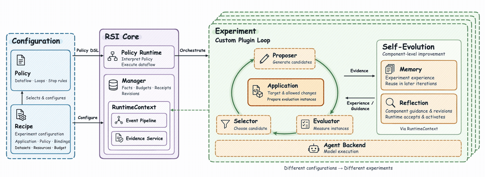
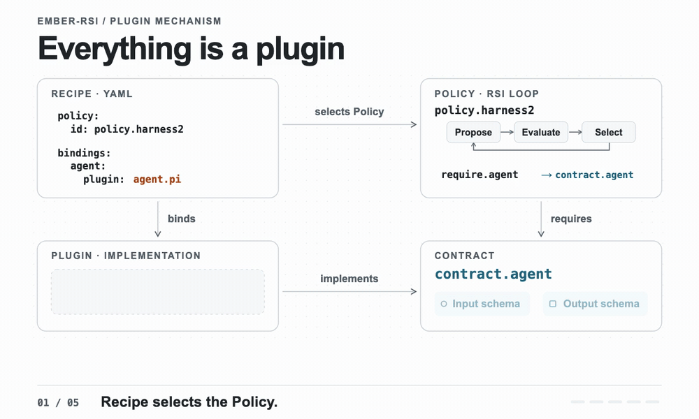

<h1 align="center">
  
</h1>

<h3 align="center">Multiple self-improvement strategies in one framework · Make Everything RSI-able.</h3>

<p align="center">
  Generate candidates, evaluate their performance, and iterate in one framework, from agent harnesses to AI infrastructure.
</p>

<p align="center">
  
  
  
</p>

<p align="center">
  English | <a href="./README.zh-CN.md">中文</a>
</p>

<p align="center">
  <a href="#when-to-use">When to use</a> ·
  <a href="#overview">Overview</a> ·
  <a href="#architecture">How it works</a> ·
  <a href="#extensions">Everything is a plugin</a> ·
  <a href="#installation">Installation</a> ·
  <a href="#usage">Using ember-rsi</a> ·
  <a href="#built-in-rsi-strategies">Built-in RSI strategies</a> ·
  <a href="#user-guide">User guides</a>
</p>

<a id="when-to-use"></a>

## 🎯 When to use ember-rsi

When you want AI to help continuously improve agents, models, or AI infrastructure, `ember-rsi` provides built-in strategies, an extensible plugin system, and a companion Skill to help you quickly start experiments in Agent Skill optimization, inference engine tuning, and more.

| Typical scenario                                                          | Environment and integration setup                                                                                                                                                                                              | What to tell AI                                                                                                                                                                                                                                                                                                    |
| ------------------------------------------------------------------------- | ------------------------------------------------------------------------------------------------------------------------------------------------------------------------------------------------------------------------------ | ------------------------------------------------------------------------------------------------------------------------------------------------------------------------------------------------------------------------------------------------------------------------------------------------------------------ |
| **Evolve Harness Skills through task feedback**                           | Prepare a working Harness, tasks, and evaluation criteria, and reuse or implement [execution and evaluation plugins](docs/users/guides/writing-plugins.md).                                                                    | “Use ember-rsi to improve this Harness's Skills, edit only Skill files, iterate on my tasks within my budget, and test the results on new tasks.”                                                                                                                                                                  |
| **Automatically search for configuration parameters that fit your needs** | Provide parameter ranges, optimization metrics, and constraints, and integrate plugins that apply configurations and evaluate their effects.                                                                                   | “Use ember-rsi to tune this configuration within the given ranges and budget, optimize the target metric while meeting constraints, and deliver the best configuration measured in this experiment with comparison results.”                                                                                       |
| **Evolve an operator toward a correct implementation with lower latency** | Prepare the operator source and a test environment, integrate evaluation plugins, and extend the proposal plugin and Policy to invoke [Memory](docs/users/guides/memory.md) and [Reflection](docs/users/guides/reflection.md). | “Use ember-rsi to iterate on this operator: have Memory summarize effective optimizations and lessons from failures, and Reflection refine the proposing Agent's prompts and guidance for later rounds; check correctness and compare latency within budget, then independently re-evaluate against the baseline.” |

<a id="overview"></a>

## ℹ️ Overview

`ember-rsi` is a pluggable framework for recursive self-improvement experiments on agents and AI infrastructure.

- **Recipe-driven self-improvement.** A declarative Recipe (`recipe.yaml`) connects an optimization target (Application), a strategy (Policy), and an Evaluator. Each experiment runs within explicit edit boundaries and a fixed budget.
- **Built-in strategies and extensions.** Built-in strategies include Harness², WikiSkill, and GEPA for agent harness optimization, plus inference parameter search and operator optimization. You can bring other targets into the same framework by defining allowed changes, generating candidates, and measuring their performance.
- **For developers and coding agents.** Developers can configure and run experiments from the CLI and inspect the results in the web viewer. Coding agents can use the same tools through the RSI Skill. Our goal is for them to plan, validate, run, and diagnose experiments, then choose the next step based on evaluation results within the scope and budget a developer authorizes.

<a id="architecture"></a>

## 🔄 How it works

### Architecture overview



1. **Define the optimization target.** Select an Application in the Recipe and configure the baseline and allowed edits. The Application also defines how to turn a candidate into an instance for the Evaluator.
2. **Run the optimization loop.** The Runtime follows the Policy. The Application initializes the baseline, validates and commits edits from the Proposer, and provides and releases instances for the Evaluator. The Selector uses evaluation results or deliverables to choose the next starting point.
3. **Improve the components.** A Policy can use Memory to retain experience and Reflection to improve component prompts, resources, or configuration from execution evidence.

<a id="extensions"></a>

### Everything is a plugin



_Harness² example · The Proposer references the `agent` binding. Changing that binding in the Recipe routes the same call from `agent.pi` to `agent.codex` on the next run._

- **Application (optimization target and instantiation)** is the core plugin selected under `application` in the Recipe. It defines what to optimize, what may change, and how to prepare and release candidate instances for evaluation. Built-in Applications manage Agent Bundles, inference service configurations, and Triton-Ascend kernels.
- **Policy (optimization strategy)** defines the RSI loop, stopping conditions, and the contract each plugin binding requires.
- **Plugin** implements a contract. The contract specifies the inputs and outputs, and implementations that satisfy it can be swapped.
- **Recipe** selects the Application and Policy, binds the plugins used by the flow, and supplies configuration and budgets.
- [Choose an Application](docs/users/guides/built-in-components.md#application)
- [Write a Policy](docs/users/guides/writing-policies.md)
- [Write a plugin](docs/users/guides/writing-plugins.md)
- [Assemble an experiment with a Recipe](docs/users/guides/configuration.md#recipe-fields-and-binding-overrides)

<a id="installation"></a>

## 📦 Installation and deployment

### Installation instructions for coding agents

Copy this instruction into your coding agent:

```text
Install the ember-rsi CLI and companion skill from https://github.com/evolving-foundry/ember-rsi.
Follow the README's manual CLI installation instructions: check prerequisites, clone the repository, install dependencies, build, and install the CLI.
Copy the complete skills/ember-rsi directory, including references and templates, into a skill directory supported by this agent. Ask before replacing an existing skill with the same name.
Run ember-rsi --help and confirm that this agent can discover and read the skill. Complete installation only; do not start experiments or make model calls.
```

### Manual installation

#### 1. Install the CLI

Requirements

1. **Node.js** >= 24.19.0 and < 25.
2. **pnpm** 11.22.0.
3. **Git**, required to fetch the AgentBundle and Evaluator SDK dependencies.

```sh
# Clone and build ember-rsi.
git clone git@github.com:evolving-foundry/ember-rsi.git
cd ember-rsi
pnpm install --frozen-lockfile
pnpm build
pnpm add -g .

# Verify that the installed CLI is available.
ember-rsi --help
```

#### 2. Install the skill

Run this from your target project and select the coding agent to install to:

```sh
npx skills add evolving-foundry/ember-rsi --skill ember-rsi
```

Add `-g` for a user-wide installation. Reload or restart your agent as required, then confirm that it can discover and read the `ember-rsi` skill.

Load the RSI Skill in a coding agent and provide the optimization goal, permitted edits, and budget. The agent can choose or write a Recipe, validate the configuration, and, once authorized, run the experiment, inspect results, and diagnose failures.

- **RSI Skill** starts at [SKILL.md](skills/ember-rsi/SKILL.md). Keep the complete `skills/ember-rsi/` directory when loading it so the agent can access its reference material and templates. Use the [minimal example](skills/ember-rsi/references/quickstart.md) to check that the Recipe and plugins work together.

Run all subsequent commands from the `ember-rsi` repository root using the installed `ember-rsi` CLI.

<a id="usage"></a>

## 🛠️ Using ember-rsi

### Quick start

#### 1. Configure models and the evaluation environment

This walkthrough uses the WorkBuddy Office scenario from the [Harness² example](examples/harness/dsh-harness2/README.md). Follow the [Evaluator's WorkBuddy setup guide](https://github.com/evolving-foundry/ember-evaluator/blob/master/docs/users/benchmarks/workbuddy.md) to prepare Docker, the dataset, and container images. Make sure both the host and the evaluation containers can reach the model endpoint.

```bash
# Set these variables in the terminal where you run ember-rsi. ember-rsi does not load .env files automatically.

# Optimizer model used to propose candidate changes.
export MODEL_NAME="your-optimizer-model"

# Model used by the evaluated agent. There is no fixed default.
# Set this to a model supported by your endpoint.
export EVALUATOR_MODEL_NAME="your-evaluation-model"

# Endpoint and API key shared by both models by default.
export MODEL_ENDPOINT="https://your-model-service.example/v1"
export MODEL_API_KEY="your-api-key"
```

#### 2. Validate, run, and resume an experiment

The Harness² example optimizes an AgentBundle baseline across 10 tasks, with up to 40 evaluations and a 72-hour time budget. For a first run, keep just the first task in `policy.config.dataset.taskIds` in [recipe.yaml](examples/harness/dsh-harness2/recipe.yaml).

```sh
# Validate the Recipe without starting the experiment.
ember-rsi doctor examples/harness/dsh-harness2/recipe.yaml

# Start the experiment with this ID. This makes real model calls.
ember-rsi run examples/harness/dsh-harness2/recipe.yaml --id my-harness2-task
```

- Candidates, evaluation metrics, call receipts, and evidence are stored in `.rsi/` in the current directory by default. Review the evaluation status, scores, and deliverables together.
- For details, see the [getting started guide](docs/users/getting-started.md), [Reflection guide](docs/users/guides/reflection.md), and [runtime events guide](docs/users/guides/runtime-events.md).

Resume an interrupted experiment from the original working directory using the same Recipe and experiment ID.

```sh
# Resume from the saved checkpoint.
ember-rsi run examples/harness/dsh-harness2/recipe.yaml --id my-harness2-task --resume
```

### Check experiment progress

Run both commands from the same directory where you ran `ember-rsi run`. They read experiment data from that directory's `.rsi/` folder.

To check an experiment's status in the terminal, pass its ID to `show`.

```sh
ember-rsi show my-harness2-task
```

To view progress in the browser, start the local read-only dashboard and open the address printed in the terminal.

```sh
ember-rsi dashboard
```

<a id="built-in-rsi-strategies"></a>

## 🧩 Built-in RSI strategies

<table>
  <thead>
    <tr>
      <th>Optimization type</th>
      <th>Policy</th>
      <th>How it improves the target</th>
      <th>Example Recipe</th>
      <th>Replaceable plugins</th>
    </tr>
  </thead>
  <tbody>
    <tr>
      <td rowspan="3" align="center"><strong>Harness</strong></td>
      <td><a href="src/policies/harness2/policy.yaml">harness2</a></td>
      <td>Proposes general and domain-specific improvements, combines them, then compares deliverables anonymously.</td>
      <td><a href="examples/harness/dsh-harness2/README.md">DSH Harness²</a></td>
      <td>
        <a href="src/plugins/agent-pi"><code>agent.pi</code></a><br>
        <a href="src/plugins/proposer-agent"><code>proposer.agent</code></a><br>
        <a href="src/plugins/evaluator-agentbench"><code>evaluator.agentbench</code></a><br>
        <a href="src/plugins/selector-artifacts"><code>selector.artifact</code></a><br>
        <a href="src/plugins/memory-agent"><code>memory.agent</code></a>
      </td>
    </tr>
    <tr>
      <td><a href="src/policies/wikiskill/policy.yaml">wikiskill</a></td>
      <td>Builds a wiki from training experience, selects skill edits by validation performance, then independently tests the final candidate after the search.</td>
      <td><a href="examples/harness/dsh-wikiskill/README.md">DSH WikiSkill</a></td>
      <td>
        <a href="src/plugins/agent-pi"><code>agent.pi</code></a><br>
        <a href="src/plugins/proposer-agent"><code>proposer.agent</code></a><br>
        <a href="src/plugins/memory-agent"><code>memory.agent</code></a><br>
        <a href="src/plugins/evaluator-agentbench"><code>evaluator.agentbench</code></a><br>
        <a href="src/plugins/selector-metrics"><code>selector.metric</code></a>
      </td>
    </tr>
    <tr>
      <td><a href="src/policies/gepa/policy.yaml">gepa</a></td>
      <td>Generates prompt variants from execution feedback and selects improvements through Pareto-frontier sampling and population search.</td>
      <td><a href="examples/harness/dsh-gepa/README.md">DSH GEPA</a></td>
      <td>
        <a href="src/plugins/agent-pi"><code>agent.pi</code></a><br>
        <a href="src/plugins/proposer-agent"><code>proposer.agent</code></a><br>
        <a href="src/plugins/proposer-pareto-evolution"><code>proposer.pareto-evolution</code></a><br>
        <a href="src/plugins/evaluator-agentbench"><code>evaluator.agentbench</code></a>
      </td>
    </tr>
    <tr>
      <td rowspan="2" align="center"><strong>Inference engine parameters</strong></td>
      <td><a href="src/policies/parameter-grid/policy.yaml">parameter-grid</a></td>
      <td>Searches a parameter grid for the highest throughput within constraints such as latency SLOs.</td>
      <td><a href="examples/artifacts/inference/parameter-grid/README.md">Inference grid search</a></td>
      <td>
        <a href="src/plugins/proposer-grid"><code>proposer.grid</code></a><br>
        <a href="src/plugins/evaluator-inferencebench"><code>evaluator.inferencebench</code></a><br>
        <a href="src/plugins/selector-metrics"><code>selector.metric</code></a>
      </td>
    </tr>
    <tr>
      <td><a href="src/policies/parameter-optuna/policy.yaml">parameter-optuna</a></td>
      <td>Searches inference parameters with Optuna TPE or random sampling.</td>
      <td><a href="examples/artifacts/inference/parameter-tpe/README.md">Inference TPE search</a></td>
      <td>
        <a href="src/plugins/proposer-optuna"><code>proposer.optuna</code></a><br>
        <a href="src/plugins/evaluator-inferencebench"><code>evaluator.inferencebench</code></a><br>
        <a href="src/plugins/selector-metrics"><code>selector.metric</code></a>
      </td>
    </tr>
    <tr>
      <td align="center"><strong>Operators</strong></td>
      <td><a href="src/policies/operator-search/policy.yaml">operator-search</a></td>
      <td>Searches for Triton-Ascend operator improvements and independently rechecks the selected candidate.</td>
      <td><a href="examples/artifacts/kernel/transpose-copy/README.md">Transpose-copy operator optimization</a></td>
      <td>
        <a href="src/plugins/agent-pi"><code>agent.pi</code></a><br>
        <a href="src/plugins/proposer-operator"><code>proposer.operator</code></a><br>
        <a href="src/plugins/evaluator-operatorbench"><code>evaluator.operatorbench</code></a><br>
        <a href="src/plugins/selector-metrics"><code>selector.metric</code></a>
      </td>
    </tr>
  </tbody>
</table>

<a id="user-guide"></a>

## 📖 User guides

- [Getting started](docs/users/getting-started.md)
- [Architecture and core concepts](docs/users/concepts/architecture.md)
- [Built-in components](docs/users/guides/built-in-components.md)
- [Configure an experiment](docs/users/guides/configuration.md)
- [Run and inspect experiments](docs/users/guides/running-experiments.md)
- [Use skills](docs/users/guides/using-skills.md)
- [Memory guide](docs/users/guides/memory.md)
- [Reflection guide](docs/users/guides/reflection.md)
- [Write a Policy](docs/users/guides/writing-policies.md)
- [Write a plugin](docs/users/guides/writing-plugins.md)
- [Runtime events guide](docs/users/guides/runtime-events.md)

## 🙏 Acknowledgments

Thanks to the maintainers and contributors of the [Cordis project](https://github.com/cordiverse/cordis). ember-rsi uses Cordis to register plugins, isolate experiment contexts, and dispatch runtime events.
