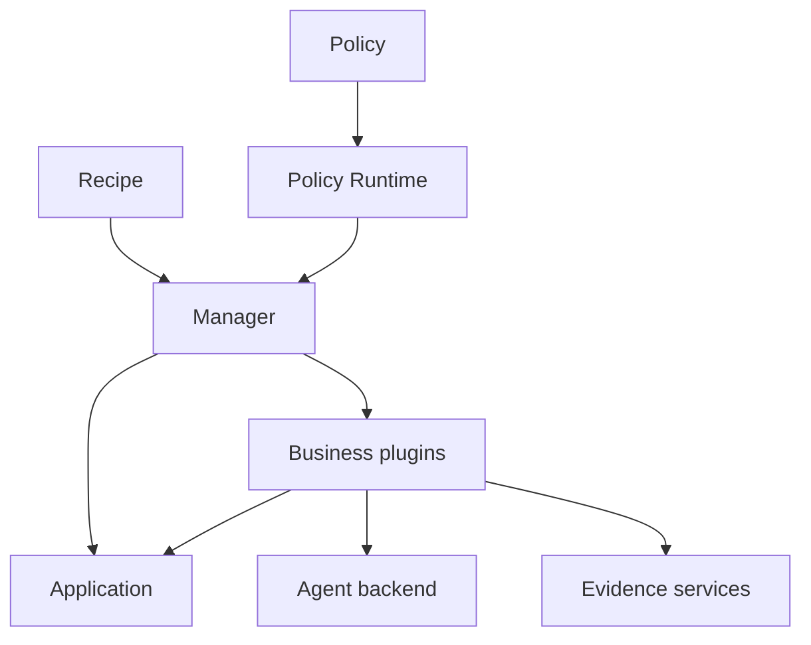

# Architecture and core concepts

English | [简体中文](architecture_zh.md) · [Getting started](../getting-started.md)

ember-rsi is a pluggable framework for recursive self-improvement experiments on agents and AI infrastructure. A Recipe configures the experiment, a Policy describes the dataflow, and the Runtime executes it and persists experiment facts.

## Core concepts

| Concept             | Responsibility                                                                                                                    |
| ------------------- | --------------------------------------------------------------------------------------------------------------------------------- |
| Application         | Own the optimization target, candidate initialization and commits, and execution-instance acquisition/release.                    |
| Plugin              | Implement one public capability such as proposing, evaluating, selecting, maintaining Memory, or generating Reflection proposals. |
| Policy              | Orchestrate calls, state, conditions, loops, and stopping rules using YAML dataflow.                                              |
| Recipe              | Select an Application and Policy, supply configuration and bindings, and set experiment budgets.                                  |
| Runtime and Manager | Register and compile capabilities; own facts, budgets, call receipts, instance leases, revision activation, and recovery.         |

A plugin implements one [public contract](../../../src/contracts/plugin-types/index.ts). The contract owns input/output schemas; each implementation owns its configuration schema and an `execute(input, context)` method. Separate bindings can use the same implementation with different configurations.

## Execution flow

For example, the [Harness² Policy](../../../src/policies/harness2/policy.yaml) binds `domainProposer` to `proposer.agent`:

1. The Recipe selects `policy.harness2` and supplies task IDs and an initial candidate.
2. `require.domainProposer` requires `contract.proposer`; `defaults.bindings.domainProposer` selects the implementation and its static configuration.
3. A `use: domainProposer` step passes dynamic input through `with`: the parent candidate, goal, evidence references, and optional Memory reference.
4. The Proposer reads the parent candidate and authorized evidence, assembles its prompt/resources, and invokes the Agent binding selected by `agentRef`.
5. It applies validated edits in a temporary workspace and calls the Application's `commit` action. The Application enforces the Target and returns a candidate/diff reference or a no-change result.
6. Subsequent evaluator and selector calls measure the candidate and choose the result. The Manager persists the corresponding facts and receipts.

See the [Proposer contract](../../../src/contracts/plugin-types/proposer.ts), [implementation](../../../src/plugins/proposer-agent/service.ts), and [shared editing configuration](../../../src/plugins/shared/agent-editing/schema.ts).

At startup, the Runtime registers plugins and Policies, resolves contracts against the registry, and compiles the dataflow. The Policy Runtime executes the flow and its state updates. The Manager mediates calls, budgets, instance leases, and experiment facts. Recovery uses saved checkpoints and call receipts. Steps can pass candidates, measurements, and evidence by reference, and the Web workspace reads experiment records through management and query interfaces. See the [Runtime implementation](../../../src/runtime/) and the [Policy compiler](../../../src/runtime/compiler/).

## Targets and evidence

For file-based Applications, a [Target](../../../examples/harness/dsh-harness2/target.yaml) defines allowed file patterns, operations, encodings and size limits, protected paths, and commit-wide change limits. Candidate edits must pass those checks.

Evidence services provide projections for model-backed plugins:

| View               | Intended input                                                                                                                      |
| ------------------ | ----------------------------------------------------------------------------------------------------------------------------------- |
| `execution`        | Sanitized execution evidence, excluding structured evaluator scores, rewards and grading feedback. Harness² uses this for learning. |
| `training-summary` | Execution evidence plus training scores and bounded evaluation feedback. WikiSkill uses this for learning.                          |
| `delivery`         | Anonymous deliverable content for artifact selection, without evaluator scores.                                                     |

Use [Runtime evidence services](../../../src/runtime/services/facts/evidence.ts) rather than supplying raw evaluator records to optimizer models. Projections can omit or shorten content; missing evidence remains unknown. These services and Target checks do not sandbox arbitrary third-party plugin code. A Policy must also keep held-out tasks out of learning input.

## Memory and Reflection

Memory stores experience as an artifact reference in experiment state, such as `state.wikiRef`. Later calls receive it through `memoryRef`; writing Memory alone does not make every plugin consume it.

Reflection proposes changes to authorized plugin resources. The Runtime validates, persists, and activates revisions **within the current experiment**. Later calls must read and use the revised resources for a change to affect execution. A new experiment does not automatically inherit those revisions or overwrite the source Policy files.

See the [built-in components](../guides/built-in-components.md) and the [Reflection guide](../guides/reflection.md) for configuration and activation.
