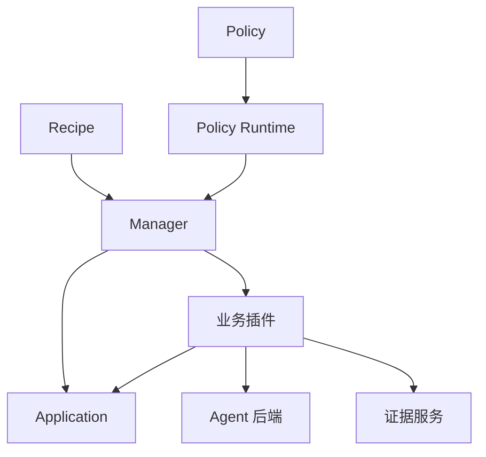

# 架构与核心概念

[English](architecture.md) | 简体中文 · [快速入门](../getting-started_zh.md)

ember-rsi（Recursive Self-Improvement）是面向 Agent 和 AI 基础设施的插件化自演进实验框架。Recipe 配置实验，Policy 描述数据流，Runtime 执行流程并保存实验事实。

## 核心概念

| 概念                    | 职责                                                                    |
| ----------------------- | ----------------------------------------------------------------------- |
| Application（优化目标） | 管理优化目标、候选初始化与提交，以及执行实例的获取和释放。              |
| Plugin（插件）          | 实现提案、评测、选择、Memory 维护或 Reflection 提案生成等一项公开能力。 |
| Policy（策略）          | 通过 YAML 数据流编排调用、状态、条件、循环和停止规则。                  |
| Recipe（实验配方）      | 选择 Application 和 Policy，提供配置与绑定，设置实验预算。              |
| Runtime 与 Manager      | 注册和编译能力；管理事实、预算、调用收据、实例租约、版本启用和恢复。    |

一个插件实现一个 [公共契约](../../../src/contracts/plugin-types/index.ts)。契约定义输入输出 Schema；插件实现定义自己的配置 Schema 和 `execute(input, context)` 方法。不同绑定可以使用相同实现和不同配置。

## 执行链路

以 [Harness² Policy](../../../src/policies/harness2/policy.yaml) 中绑定到 `proposer.agent` 的 `domainProposer` 为例：

1. Recipe 选择 `policy.harness2`，传入任务 ID 和初始候选。
2. `require.domainProposer` 声明需要 `contract.proposer`；`defaults.bindings.domainProposer` 选择实现和静态配置。
3. `use: domainProposer` 步骤通过 `with` 传入动态输入：父候选、目标、证据引用及可选的 Memory 引用。
4. Proposer 读取父候选和授权证据，组装提示词与资源，再通过 `agentRef` 调用所选 Agent 绑定。
5. Proposer 在临时工作区应用经过校验的编辑，并调用 Application 的 `commit` 动作。Application 执行 Target 检查，返回候选与差异引用，或返回无修改结果。
6. 后续 Evaluator 和 Selector 测量候选并选择结果，Manager 保存对应事实和收据。

对应源码见 [Proposer 契约](../../../src/contracts/plugin-types/proposer.ts)、[实现](../../../src/plugins/proposer-agent/service.ts) 和 [共享编辑配置](../../../src/plugins/shared/agent-editing/schema.ts)。

Runtime 启动时注册插件和 Policy，并用注册表解析契约、编译数据流。Policy Runtime 执行流程和状态更新，Manager 负责受控调用、预算、实例租约和事实记录。实验恢复会使用已持久化的检查点与调用收据。候选、测量和证据可通过引用在步骤间传递，Web 工作台通过管理与查询接口读取这些记录。参见 [Runtime 实现](../../../src/runtime/) 和 [Policy 编译器](../../../src/runtime/compiler/)。

## Target 与证据

对于文件型 Application，[Target](../../../examples/harness/dsh-harness2/target.yaml) 定义允许的文件模式、操作、编码与大小限制、保护路径以及一次提交的修改总量限制。候选编辑必须通过这些检查。

证据服务向模型插件提供以下投影：

| 视图               | 预期输入                                                                 |
| ------------------ | ------------------------------------------------------------------------ |
| `execution`        | 脱敏执行证据，排除结构化评测分数、Reward 和判题反馈。Harness² 用它学习。 |
| `training-summary` | 执行证据，加上训练分数和有界评测反馈。WikiSkill 用它学习。               |
| `delivery`         | 用于交付物选择的匿名内容，不包含评测分数。                               |

应通过 [Runtime 证据服务](../../../src/runtime/services/facts/evidence.ts) 向优化模型提供输入，而不是直接传入原始评测记录。投影可能省略或缩短内容，缺失证据仍应视为未知。这些服务和 Target 检查不构成任意第三方插件代码的沙箱；Policy 也必须避免将独立测试任务用于学习。

## Memory 与 Reflection

Memory 将经验保存为制品引用，并存入 `state.wikiRef` 等实验状态。后续调用通过 `memoryRef` 接收它；仅写入 Memory 不会让所有插件自动使用经验。

Reflection 为授权的插件资源提出修改。Runtime 校验、持久化并启用**当前实验内**的新版本。只有后续调用读取并使用新资源，修改才参与执行。新实验不会自动继承这些版本，源 Policy 文件也不会被覆盖。

进一步了解 [内置组件](../guides/built-in-components_zh.md) 和 [Reflection 使用](../guides/reflection_zh.md)。
