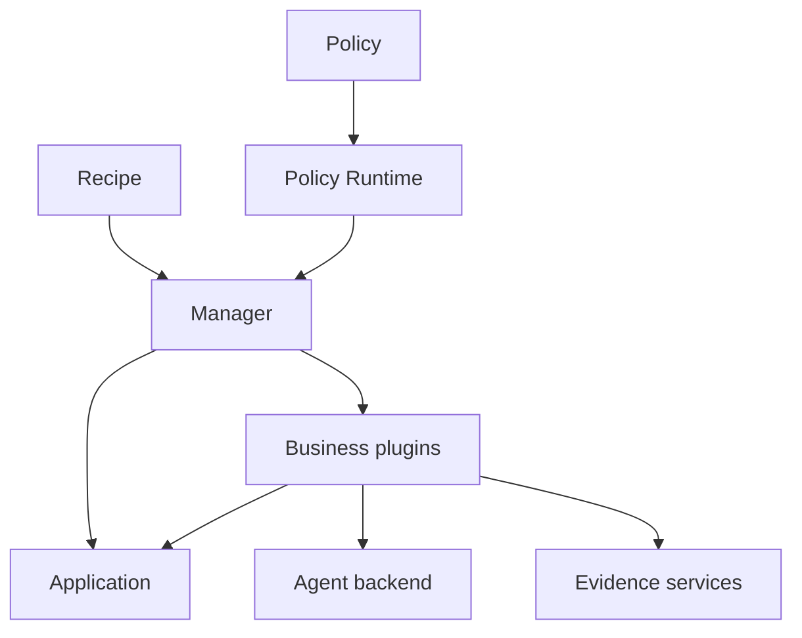

# ember-rsi user guide

English | [简体中文](../zh-CN/guide.md) · [Reflection](reflection.md) · [Runtime events](runtime-events.md) · [Parameter search](parameter-search.md)

ember-rsi (Recursive Self-Improvement) is a pluggable framework for self-improvement experiments on agents and AI infrastructure. This guide describes the current source interfaces. The Evaluator SDK is installed and built by pnpm from a pinned [ember-evaluator](https://github.com/evolving-foundry/ember-evaluator) commit, using `ember-evaluator` as its dependency/import name; a sibling Evaluator checkout is not required. Follow the [installation instructions](../../../README.md) before running the commands below from the repository root.

## 1. Concepts and execution flow

| Concept             | Responsibility                                                                                                                    |
| ------------------- | --------------------------------------------------------------------------------------------------------------------------------- |
| Application         | Own the optimization target, candidate initialization and commits, and execution-instance acquisition/release.                    |
| Plugin              | Implement one public capability such as proposing, evaluating, selecting, maintaining Memory, or generating Reflection proposals. |
| Policy              | Orchestrate calls, state, conditions, loops, and stopping rules using YAML dataflow.                                              |
| Recipe              | Select an Application and Policy, supply configuration and bindings, and set experiment budgets.                                  |
| Runtime and Manager | Register and compile capabilities; own facts, budgets, call receipts, instance leases, revision activation, and recovery.         |

A plugin implements one [public contract](../../../src/contracts/plugin-types/index.ts). The contract owns input/output schemas; each implementation owns its configuration schema and an `execute(input, context)` method. Separate bindings can use the same implementation with different configurations.



For example, the [Harness² Policy](../../../src/policies/harness2/policy.yaml) binds `domainProposer` to `proposer.agent`:

1. The Recipe selects `policy.harness2` and supplies task IDs and an initial candidate.
2. `require.domainProposer` requires `contract.proposer`; `defaults.bindings.domainProposer` selects the implementation and its static configuration.
3. A `use: domainProposer` step passes dynamic input through `with`: the parent candidate, goal, evidence references, and optional Memory reference.
4. The Proposer reads the parent candidate and authorized evidence, assembles its prompt/resources, and invokes the Agent binding selected by `agentRef`.
5. It applies validated edits in a temporary workspace and calls the Application's `commit` action. The Application enforces the Target and returns a candidate/diff reference or a no-change result.
6. Subsequent evaluator and selector calls measure the candidate and choose the result. The Manager persists the corresponding facts and receipts.

See the [Proposer contract](../../../src/contracts/plugin-types/proposer.ts), [implementation](../../../src/plugins/proposer-agent/service.ts), and [shared editing configuration](../../../src/plugins/shared/agent-editing/schema.ts).

### Targets and evidence

For file-based Applications, a [Target](../../../examples/harness/dsh-harness2/target.yaml) defines allowed file patterns, operations, encodings and size limits, protected paths, and commit-wide change limits. Candidate edits must pass those checks.

Evidence services provide projections for model-backed plugins:

| View               | Intended input                                                                                                                      |
| ------------------ | ----------------------------------------------------------------------------------------------------------------------------------- |
| `execution`        | Sanitized execution evidence, excluding structured evaluator scores, rewards and grading feedback. Harness² uses this for learning. |
| `training-summary` | Execution evidence plus training scores and bounded evaluation feedback. WikiSkill uses this for learning.                          |
| `delivery`         | Anonymous deliverable content for artifact selection, without evaluator scores.                                                     |

Use [Runtime evidence services](../../../src/runtime/services/facts/evidence.ts) rather than supplying raw evaluator records to optimizer models. Projections can omit or shorten content; missing evidence remains unknown. These services and Target checks do not sandbox arbitrary third-party plugin code. A Policy must also keep held-out tasks out of learning input.

### Memory and Reflection

Memory stores experience as an artifact reference in experiment state, such as `state.wikiRef`. Later calls receive it through `memoryRef`; writing Memory alone does not make every plugin consume it.

Reflection proposes changes to authorized plugin resources. The Runtime validates, persists, and activates revisions **within the current experiment**. Later calls must read and use the revised resources for a change to affect execution. A new experiment does not automatically inherit those revisions or overwrite the source Policy files.

Harness² declares a Reflection configuration, but its `improve_guidance` step is currently commented out. Reflection does not run by default. See the [Reflection guide](reflection.md) for explicit invocation and persistence.

## 2. Run and inspect an experiment

### Environment and models

Prepare the source installation, Docker, benchmark downloads/images, and model access described in the [README](../../../README.md). The model endpoint must be reachable from the host and evaluation containers when both use it.

```sh
export MODEL_NAME="your-optimizer-model"
export EVALUATOR_MODEL_NAME="your-evaluation-model"
export MODEL_ENDPOINT="https://your-model-service.example/v1"
export MODEL_API_KEY="your-api-key"
```

RSI does not automatically load `.env` files. Export variables in the process that starts the CLI or Web service. `agent.pi` resolves its model fields at execution time; its API-key configuration uses an environment-variable reference rather than a literal secret.

The optimizer Agent and the evaluated solver can use different models. In the Harness² Recipe, `bindings.evaluator.config.services.default.model` reads the required `EVALUATOR_MODEL_NAME` environment variable separately from `MODEL_NAME`, with no fixed default.

The [Agent configuration schema](../../../src/plugins/agent-pi/schema.ts) defaults to `thinkingLevel: low`, `maxTokens: 32768`, `contextWindow: 262144`, `timeoutMs: 600000`, and `retries: 0`. You can explicitly set `thinkingLevel: off`. Choose limits and reasoning settings supported by your endpoint. These defaults configure RSI's Agent backend; they do not set the evaluated solver's reasoning behavior.

Every `agent.pi` session provides `run_subagent` by default, including child sessions. Agents decide whether and how to delegate recursively, with no additional depth or subagent-count limit. All levels share the Runtime budget and cancellation; a new child does not reset the budget. Each child uses the same Agent binding with an independent conversation and explicitly supplied virtual files. See [how Reflection works](reflection.md#how-reflection-works).

To use the installed Codex CLI and its existing local login, provider, model and reasoning configuration, replace the Agent binding with:

```yaml
bindings:
  agent:
    ref: agent.codex
    config: {}
```

Run `codex login status` as the same operating-system user that starts RSI; sign in with `codex login` if needed. RSI inherits `CODEX_HOME` and the provider's environment variables. The installed CLI must support app-server configuration queries, ephemeral threads and experimental dynamic tools (verified with Codex CLI 0.166.0). The [Codex configuration schema](../../../src/plugins/agent-codex/schema.ts) accepts `executable` (default `codex`), `timeoutMs` (default `600000`), and optional `model`. Omit `model` to use the local default; set it (for example, `config: { model: your-model }`) to select a model for this execution without changing local configuration or authentication. Remove earlier `base_url`, `api_key`, and `thinkingLevel` fields. The local provider must use the Responses API. RSI routes model requests through its local gateway to enforce per-request budgets and permit only its virtual `read_file` tool. Initial context contains file names; contents are read on demand, defaulting to 200 lines and a 16 KiB serialized response, with at most 500 lines and 32 KiB per read. Use `startLine`/`lineCount` for line ranges and `byteOffset`/`nextByteOffset` to page within the selected range, including a single long JSON line. Codex owns conversation history and compaction; RSI does not inject hidden evidence into outgoing requests. Initial task metadata is limited to 128 KiB; put large evidence in virtual files. Context-window errors are terminal. Local model/developer instructions, hooks, MCP servers and plugins are excluded from task execution. Effective model, provider, reasoning, CLI version and non-secret configuration fingerprints are recorded; changes within the same experiment and binding are rejected, including after resume. Restore the recorded settings or start a new experiment. This binding configures the optimizer only; evaluator model credentials remain independently required.

### Recipe configuration

Start from a complete example and keep its `recipe.yaml`, `target.yaml`, and `baseline/` together. Relative resource paths are resolved against the file that declares them. This is a reduced Harness² Recipe with one task:

```yaml
schemaVersion: rsi.recipe/v1
id: harness2-one-task
application:
  ref: application.agentbundle
  config:
    target: { schema: ./target.yaml }
    baseline: { directory: ./baseline }
policy:
  ref: policy.harness2
  input:
    candidateRef: ${{ application.initialCandidate }}
  config:
    k: 1
    concurrency: 1
    memory: true
    dataset:
      taskIds:
        - workbuddy/board-material-update-timeline-excel
bindings:
  agent:
    ref: agent.pi
    config:
      thinkingLevel: low
  evaluator:
    ref: evaluator.agentbench
    config:
      services:
        default:
          model: ${EVALUATOR_MODEL_NAME}
          maxTokens: 65536
          base_url: ${MODEL_ENDPOINT}
          api_key: ${MODEL_API_KEY}
      benchmark:
        name: workbuddy
        scenario: office
        solver:
          name: agentbundle
      scheduler:
        name: local
        concurrency: 1
      run:
        timeoutSeconds: 4500
budget:
  operations: 1400
  evaluationRuns: 4
  modelCalls: 1400
  elapsedWallMs: 259200000
  cleanupReserveMs: 60000
```

Place it beside the [Harness² baseline and Target](../../../examples/harness/dsh-harness2/README.md), and replace the model with one your endpoint supports. The evaluator model must support the configured output limit. Budgets are ceilings, not expected usage or a cost estimate.

Harness² accepts `k`, `concurrency`, `dataset.taskIds`, and `memory` in `policy.config`. Goals and the delivery rubric are defined by the Policy; `goals` and `deliveryRubric` are not accepted configuration fields. `k` controls exploration slots; `concurrency` limits concurrent Policy branches. The Evaluator scheduler has a separate concurrency setting. With fixed `k`, the current flow makes `4 × k × task count` evaluator calls (base, invariant, domain, composition); one evaluator call can contain multiple tasks in other Policies.

[WikiSkill](../../../examples/harness/dsh-wikiskill/README.md) instead accepts `maxRounds`, optional `stopAtScore`, and disjoint `trainTaskIds`, `validationTaskIds`, and `testTaskIds` under `dataset`. It learns from training evidence, gates candidates on validation measurements, and evaluates independent test tasks in `finish`. Its Recipe selects `linux/amd64` task images, including on ARM64 hosts; Docker/emulation and benchmark prerequisites still apply. Consult the [current Recipe](../../../examples/harness/dsh-wikiskill/recipe.yaml) and [Policy schema](../../../src/policies/wikiskill/schemas/wikiskill-config.yaml) before changing fields.

### CLI

```sh
ember-rsi validate examples/harness/dsh-harness2/recipe.yaml
ember-rsi run examples/harness/dsh-harness2/recipe.yaml --id my-harness2-task
ember-rsi list
ember-rsi show my-harness2-task
ember-rsi cancel my-harness2-task
ember-rsi catalog
```

`validate` checks configuration, contracts, bindings, and declared Reflection resources; it does not run a model, prepare benchmark images, or establish model/network/hardware readiness. A valid Recipe can still fail during execution. `cancel` requests cancellation; inspect the saved status afterward.

Use the same working directory, Recipe, and experiment ID to resume an interrupted experiment:

```sh
ember-rsi run examples/harness/dsh-harness2/recipe.yaml --id my-harness2-task --resume
```

The default store is `.rsi/` under the current directory. Completed calls can reuse saved receipts and checkpoints; unknown external outcomes require reconciliation and are not a guarantee of exactly-once execution. Inspect status, measurements, and evidence separately: a zero score is not necessarily an execution failure. Model-output correction in `agent.pi` is bounded and charged to the model-call budget; transport retries remain disabled unless configured.

### Web observation

```sh
ember-rsi serve --port 4317
```

Open `http://127.0.0.1:4317`. The built Web UI is a **read-only observation workspace** for experiment lists, summaries, candidates, measurements, calls, and charts. Start, resume, and cancel experiments through the CLI; the current UI has no Recipe editor, start button, or cancellation button. Separate CLI and server processes use the same on-disk store when started from the same directory.

`pnpm dev:web` starts Vite development mode and proxies `/api` to port 4317 by default; it needs a backend. `serve` serves built assets. The server listens on loopback and checks Host/Origin; it does not provide user authentication for a public deployment.

## 3. Customize bindings and plugins

### Choose the extension boundary

| Need                                                                               | Extension                                                     |
| ---------------------------------------------------------------------------------- | ------------------------------------------------------------- |
| Change tasks, limits, model, or existing prompt paths                              | Override the corresponding Recipe configuration or binding.   |
| Replace inference/tool execution while reusing Proposer evidence and edit handling | Implement `contract.agent` and replace the `agent` binding.   |
| Replace the complete proposal workflow                                             | Implement `contract.proposer` and replace a Proposer binding. |
| Change orchestration, state, or stopping rules                                     | Register a custom Policy.                                     |

Bindings merge at the binding/configuration level; they are not an arbitrary recursive merge. Inspect the [loader](../../../src/runtime/loaders/index.ts) when replacing nested configuration. A `ref` selects a registered implementation; it does not import a file or register code.

Organize a plugin around `schema.ts` (configuration), `service.ts` (business behavior and cleanup), and `index.ts` (definition assembly). Reuse the public contract's input/output schemas. Repository plugins import local contracts; external packages use `ember-rsi` or `ember-rsi/contracts`, not private `src/*` imports.

A custom Agent must return an object matching the requested `input.outputSchema`, enforce its authorized tools/files, propagate cancellation, charge actual model attempts with `context.charge('modelCalls', 1)`, and release resources. Implementing the Agent contract does not automatically enforce the requested output schema inside an arbitrary backend; the backend must validate it. For the built-in Proposer, the edit protocol is defined in [shared editing code](../../../src/plugins/shared/agent-editing/index.ts).

### Register an external extension for the CLI

Default extensions load from `~/.ember-rsi/plugins/<name>/index.mjs` in name order, before extra `--plugin-dir` directories. A missing home is allowed; invalid discovered extensions fail startup. Experiment data remains in the working directory's `.rsi/`. Embedded hosts can set `homeDirectory: false` for isolation.

`ember-rsi list plugins` and `ember-rsi list policies` expose descriptions, input/output/config Schemas, contracts and compatible bindings. Compatibility means contract matching, not task suitability. Bare `ember-rsi list` still lists experiments; `ember-rsi catalog` retains compact ID lists.

Every CLI command accepts repeatable `--plugin-dir <directory>` options. Each directory contains an ESM `index.mjs` exporting `register(registry)`. The extension and its dependencies must be built/resolvable before loading:

```js
// my-extension/index.mjs
import { myAgentDefinition } from './agent.js';

export function register(registry) {
  registry.registerOperation(myAgentDefinition);
}
```

Set `bindings.agent.ref: agent.my-custom` in your Recipe, matching the definition's ID, then pass the extension on each command that needs it:

```sh
ember-rsi validate ./my-recipe/recipe.yaml --plugin-dir ./my-extension
ember-rsi run ./my-recipe/recipe.yaml --id custom-run --plugin-dir ./my-extension
```

For a built-in repository extension, add its definition to [registerBuiltins](../../../src/runtime/builtins.ts) and rebuild. Creating a source file alone does not register it.

### Embed the Runtime

An external host can register definitions directly. Validation and execution must use a Runtime with the same registrations:

```ts
import { resolve } from 'node:path';
import { createRuntime, validateRecipe } from 'ember-rsi';
import { myAgentDefinition } from './plugins/agent-custom/index.js';

const runtime = await createRuntime({ rootDirectory: process.cwd() });
try {
  runtime.registry.registerOperation(myAgentDefinition);
  const recipePath = resolve('./my-recipe/recipe.yaml');
  const check = await validateRecipe(runtime, recipePath);
  console.log(check);
  const result = await runtime.manager.run(recipePath, { id: 'custom-run' });
  console.log(result.status, result.output);
} finally {
  await runtime.dispose();
}
```

Direct registration in a host process does not modify a separately started CLI process. Use that host for management calls, or load the same extension through `--plugin-dir`. Never persist live `RuntimeContext` objects as JSON.

## 4. Write a Policy

Policies use `rsi.policy/v1`; Recipes use `rsi.recipe/v1`. A Policy declares input, output, and configuration schemas, required contract IDs, optional default bindings, and its execution flow. See [Harness²](../../../src/policies/harness2/policy.yaml), [WikiSkill](../../../src/policies/wikiskill/policy.yaml), and the [Policy compiler](../../../src/runtime/compiler/).

| Construct | Behavior                                                                            |
| --------- | ----------------------------------------------------------------------------------- |
| `use`     | Call a required binding or the explicitly configured `reflection` module.           |
| `state`   | Persist state updates. Parallel branches cannot mutate shared state.                |
| `if`      | Execute conditional branches.                                                       |
| `foreach` | Iterate with stable unique keys, bounded concurrency, and optional `yield` results. |
| `loop`    | Run a nested loop. The top-level loop supports `maxIterations` and `while`.         |
| `control` | `break`, `continue`, or `fail` with a reason.                                       |

`init`, `loop`, and `finish` organize lifecycle stages. Expressions such as `${{ input.candidateRef }}` and `${{ loop.propose.output.candidateRef }}` connect data through the supported expression language and pure functions. They do not execute arbitrary JavaScript. Recipe paths and IDs must still be valid for the selected implementation.

A typical search flow initializes an incumbent and validation measurement, proposes a candidate, evaluates only changed candidates, selects by metrics, updates state on acceptance, and reports a final held-out measurement in `finish`. Reflection requires an explicit serial `use: reflection` step; do not place it in a parallel branch.

Register a custom Policy from a compiled extension (the paths below are relative to that extension module):

```js
import { fileURLToPath } from 'node:url';
import { readPolicy } from 'ember-rsi';

export async function register(registry) {
  const file = fileURLToPath(new URL('./policy.yaml', import.meta.url));
  const policy = await readPolicy(file, registry);
  registry.registerPolicy(String(policy.definition.id), file);
}
```

Register required plugin definitions before reading a Policy that uses their contracts. Reference the registered Policy ID in the Recipe and supply all required bindings. After source changes, use `pnpm build`; for engineering verification use the existing `pnpm check` entrypoint. Real model/benchmark experiments are separate from deterministic checks.

## 5. Use the AI skill

The repository includes [skills/ember-rsi](../../../skills/ember-rsi/SKILL.md) for configuring experiments, developing plugins, and diagnosing runs. Make the skill available to your coding assistant and ask it to verify the target checkout's interfaces before applying examples; some references are explicitly historical.

Examples of useful requests:

- Copy the Harness² Recipe for one task, set a supported optimizer/evaluation model, recalculate budgets, and validate without starting a real run.
- Implement `contract.agent`, register the extension, and bind it to the Harness² `agent` slot.
- Inspect an experiment's receipts and evidence to explain which edits were accepted and why a deliverable was selected, distinguishing failed execution from a low score.
