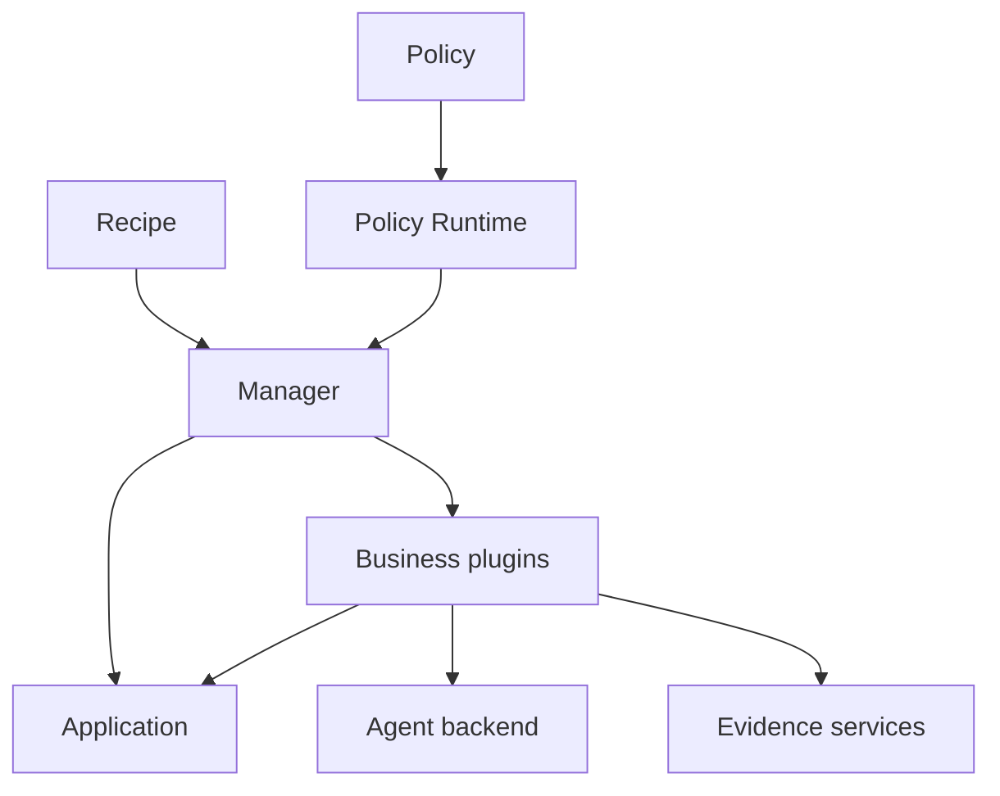

# ember-rsi user guide

English | [简体中文](../zh-CN/guide.md) · [Reflection](reflection.md) · [Runtime events](runtime-events.md) · [Parameter search](parameter-search.md)

ember-rsi (Recursive Self-Improvement) is a pluggable framework for self-improvement experiments on agents and AI infrastructure. This guide describes the current source interfaces. The Evaluator SDK is installed and built by pnpm from a pinned [ember-evaluator](https://github.com/evolving-foundry/ember-evaluator) commit, using `ember-evaluator` as its dependency/import name; a sibling Evaluator checkout is not required. Follow the [installation instructions](../../../README.md) before running the commands below from the repository root.

## 1. Concepts and execution flow

| Concept             | Responsibility                                                                                                                    |
| ------------------- | --------------------------------------------------------------------------------------------------------------------------------- |
| Application         | Own the optimization target, candidate initialization and commits, and execution-instance acquisition/release.                    |
| Plugin              | Implement one public capability such as proposing, evaluating, selecting, maintaining Memory, or generating Reflection proposals. |
| Policy              | Orchestrate calls, state, conditions, loops, and stopping rules using YAML dataflow.                                              |
| Recipe              | Select an Application and Policy, supply configuration and bindings, and set experiment budgets.                                  |
| Runtime and Manager | Register and compile capabilities; own facts, budgets, call receipts, instance leases, revision activation, and recovery.         |

A plugin implements one [public contract](../../../src/contracts/plugin-types/index.ts). The contract owns input/output schemas; each implementation owns its configuration schema and an `execute(input, context)` method. Separate bindings can use the same implementation with different configurations.

Evaluator plugins use the installed Evaluator SDK's configuration types and parser. RSI binds the candidate, selected tasks, and per-call output directory, then writes the SDK-parsed configuration before charging the evaluation budget. Use environment references for credentials. The SDK applies defaults and validates benchmark-specific options when evaluation starts. An error at that stage consumes one `evaluationRuns` charge.

AgentBench binds the candidate Bundle to the `agentbundle` solver and replaces sampling, offset, and task-count limits with the Policy's explicit task IDs. InferenceBench requires local AgentX execution. Omitting `services` binds the candidate to the default service. For a named route, declare the service selected by `benchmark.solver.service`. That entry accepts SDK options such as `retry` and `contextWindow`. Supplying `model`, `base_url`, or `api_key` in that entry is an error. Configure the credential reference on the Application with `credentials.apiKeyEnv`. Other service entries follow the SDK requirements.

OperatorBench takes an SDK `kernel` benchmark and an RSI `task.directory`. RSI provides the service required for kernel replay. Omit `services` entirely, including empty maps. Put kernel options such as `repeat`, `python`, and `profiling` under `benchmark.config`. RSI builds the manifest from the candidate and reference, binds the selected case and seed, and stores the run index and output in the call directory. A `profile` action enables profiling and disables its cache. When migrating an existing Recipe, move kernel options from `protocol` and `sdk` to `benchmark.config`, remove `mode` and `protocol.timingScope`, and set `run.onError: abort` and `run.timeoutSeconds` to the former kernel timeout plus 30 seconds to preserve the previous run settings. See the [operator Recipe](../../../examples/artifacts/kernel/transpose-copy/recipe.search.yaml).



For example, the [Harness² Policy](../../../src/policies/harness2/policy.yaml) binds `domainProposer` to `proposer.agent`:

1. The Recipe selects `policy.harness2` and supplies task IDs and an initial candidate.
2. `require.domainProposer` requires `contract.proposer`; `defaults.bindings.domainProposer` selects the implementation and its static configuration.
3. A `type: invoke` step with `use: domainProposer` passes dynamic input through `with`: the parent candidate, goal, evidence references, and optional Memory reference.
4. The Proposer reads the parent candidate and authorized evidence, assembles its prompt/resources, and invokes the Agent binding selected by `agentRef`.
5. It applies validated edits in a temporary workspace and calls the Application's `commit` action. The Application enforces the Target and returns a candidate/diff reference or a no-change result.
6. Subsequent evaluator and selector calls measure the candidate and choose the result. The Manager persists the corresponding facts and receipts.

See the [Proposer contract](../../../src/contracts/plugin-types/proposer.ts), [implementation](../../../src/plugins/proposer-agent/service.ts), and [shared editing configuration](../../../src/plugins/shared/agent-editing/schema.ts).

### Targets and evidence

For file-based Applications, a [Target](../../../examples/harness/dsh-harness2/target.yaml) defines allowed file patterns, operations, encodings, and protected paths. Set `content.maxBytes` on a file rule to limit file size. Set `constraints.maxChangedFiles` or `constraints.maxChangedBytes` to limit the size of a commit. Candidate edits must pass the configured checks.

Evidence services provide projections for model-backed plugins:

| View               | Intended input                                                                                                                      |
| ------------------ | ----------------------------------------------------------------------------------------------------------------------------------- |
| `execution`        | Sanitized execution evidence, excluding structured evaluator scores, rewards and grading feedback. Harness² uses this for learning. |
| `training-summary` | Execution evidence plus training scores and bounded evaluation feedback. WikiSkill uses this for learning.                          |
| `delivery`         | Anonymous deliverable content for artifact selection, without evaluator scores.                                                     |

Use [Runtime evidence services](../../../src/runtime/services/facts/evidence.ts) rather than supplying raw evaluator records to optimizer models. JSON projections can omit or shorten content. Reads in `files` mode apply a byte limit only if the caller or its scope sets one. Missing evidence remains unknown. These services and Target checks do not sandbox arbitrary third-party plugin code. A Policy must also keep held-out tasks out of learning input.

### Memory and Reflection

Memory stores experience as an artifact reference in experiment state, such as `state.wikiRef`. Later calls receive it through `memoryRef`; writing Memory alone does not make every plugin consume it.

`memory.agent` returns `status: failed` with the previous `memoryRef`, `changeRef: null`, and a redacted reason when an update fails. Its call receipt remains `failed`, while the Policy can retain that reference and continue. A first failed update retains `null`. Resume reuses a persisted failed result rather than rerunning that completed update boundary. Normal `no-change` results remain distinct.

Reflection proposes changes to authorized plugin resources. The Runtime validates, persists, and activates revisions **within the current experiment**. Later calls must read and use the revised resources for a change to affect execution. A new experiment does not automatically inherit those revisions or overwrite the source Policy files.

Memory and Reflection update failures, including child Agent failures, do not by themselves cancel the experiment. Reflection records rejected updates and retains the effective guidance. User cancellation, total experiment budget exhaustion, and failures to persist critical Runtime state still stop execution.

Harness² declares a Reflection configuration, but its `improve_guidance` step is currently commented out. Reflection does not run by default. See the [Reflection guide](reflection.md) for explicit invocation and persistence.

## 2. Run and inspect an experiment

### Environment and models

Prepare the source installation, Docker, benchmark downloads/images, and model access described in the [README](../../../README.md). The model endpoint must be reachable from the host and evaluation containers when both use it.

```sh
export MODEL_NAME="your-optimizer-model"
export EVALUATOR_MODEL_NAME="your-evaluation-model"
export MODEL_ENDPOINT="https://your-model-service.example/v1"
export MODEL_API_KEY="your-api-key"
```

RSI does not automatically load `.env` files. Export variables in the process that starts the CLI or Web service. `agent.pi` resolves its model fields at execution time; its API-key configuration uses an environment-variable reference rather than a literal secret.

The optimizer Agent and the evaluated solver can use different models. In the Harness² Recipe, `bindings.evaluator.config.services.default.model` reads the required `EVALUATOR_MODEL_NAME` environment variable separately from `MODEL_NAME`, with no fixed default.

The [Agent configuration schema](../../../src/plugins/agent-pi/schema.ts) defaults to `thinkingLevel: low`, `contextWindow: 262144`, and `retries: 0`. Set `maxTokens` to request an output limit, `timeoutMs` for each model request, or `executionTimeoutMs` for the complete Agent invocation. The execution timeout includes model requests, tool calls, output correction, context compaction and retry backoff; it does not reset between requests. These fields have no implicit limits. Both timeout fields accept integer milliseconds from `1` to `2147483647`. Choose settings supported by your endpoint.

Every `agent.pi` session provides `run_subagent` by default, including child sessions. Agents decide whether and how to delegate recursively, with no additional depth or subagent-count limit. All levels share the Runtime budget and cancellation; a new child does not reset the budget or extend its parent's execution deadline. Each child uses the same Agent binding with an independent conversation and explicitly supplied virtual files. See [how Reflection works](reflection.md#how-reflection-works).

The bundled Harness² and WikiSkill Policies explicitly configure their shared `agent` binding with `retries: 3` and `retryBaseDelayMs: 2000`: eligible model requests have up to four attempts with a two-second base backoff. All callers of that binding use these settings. Override them under `bindings.agent.config` in the Recipe. Memory and Reflection do not add a component retry loop or require extra Policy failure settings.

To use the installed Codex CLI and its existing local login, provider, model and reasoning configuration, replace the Agent binding with:

```yaml
bindings:
  agent:
    plugin: agent.codex
    config: {}
```

Run `codex login status` as the same operating-system user that starts RSI; sign in with `codex login` if needed. The installed CLI must support app-server ephemeral threads and dynamic tools (verified with CLI 0.166.0). Codex reads its own local authentication, provider, instructions, permissions, tools, retries and compaction configuration. RSI starts `codex app-server` directly without a model proxy or configuration overrides. Each call runs in a temporary working directory, so it uses the configuration and global guidance effective there; it does not automatically load the RSI checkout’s project `AGENTS.md` or `.codex` settings.

The [Codex configuration schema](../../../src/plugins/agent-codex/schema.ts) accepts `executable` (default `codex`), optional `model`, and optional `timeoutMs`. Omit `model` to use the local default; set it to select a model for this call without changing local configuration. There is no implicit RSI timeout: `timeoutMs`, when explicitly supplied, bounds the complete call. Experiment cancellation and elapsed-wall budgets still propagate to the child process.

RSI supplies the business prompt as task input, a file-name list, an authorized virtual `read_file` tool, and the requested output schema. File contents are read on demand: the reader defaults to 200 lines and a 16 KiB serialized response, with at most 500 lines and 32 KiB per page. `startLine`/`lineCount` select lines; `byteOffset`/`nextByteOffset` paginate within that range, including a single long JSON line. Native Codex capabilities remain governed by the user's Codex configuration. RSI validates the final JSON and does not add a separate correction or retry loop. Interactive input/approval requests cannot be answered by this non-interactive API call and produce an explicit error; RSI does not silently approve them or change the local policy.

Native app-server events expose token usage but no authoritative upstream request-attempt counter. Consequently, this backend does not enforce `maxModelCalls` or the `modelCalls` experiment budget and does not invent a count from turns or tool calls. Diagnostics declare model-call usage unavailable; a missing RSI `modelCalls` counter does not mean Codex made zero requests. Use cancellation, the experiment wall-time budget, or explicit `timeoutMs` when a duration bound is needed. Local configuration changes apply to later calls; RSI records reported model/provider/reasoning and token usage without locking the configuration. This binding configures the optimizer only; evaluator credentials remain separate.

### Recipe configuration

Start from a complete example and keep its `recipe.yaml`, `target.yaml`, and `baseline/` together. Relative resource paths are resolved against the file that declares them. This is a reduced Harness² Recipe with one task:

```yaml
schemaVersion: rsi.recipe/v1
id: harness2-one-task
application:
  plugin: application.agentbundle
  config:
    target: { schema: ./target.yaml }
    baseline: { directory: ./baseline }
policy:
  id: policy.harness2
  input:
    candidateRef: ${{ application.initialCandidate }}
  config:
    k: 1
    concurrency: 1
    memory: true
    dataset:
      taskIds:
        - workbuddy/board-material-update-timeline-excel
bindings:
  agent:
    plugin: agent.pi
    config:
      thinkingLevel: low
      timeoutMs: 1800000
      executionTimeoutMs: 3600000
  evaluator:
    plugin: evaluator.agentbench
    config:
      services:
        default:
          model: ${EVALUATOR_MODEL_NAME}
          base_url: ${MODEL_ENDPOINT}
          api_key: ${MODEL_API_KEY}
      benchmark:
        name: workbuddy
        scenario: office
        solver:
          name: agentbundle
      scheduler:
        name: local
      run:
        timeoutSeconds: 4500
budget:
  elapsedWallMs: 259200000
```

Place it beside the [Harness² baseline and Target](../../../examples/harness/dsh-harness2/README.md), and replace the model with one your endpoint supports. The example retains the 4,500-second evaluator task timeout and 72-hour experiment wall budget. Pi uses a 30-minute request timeout and 60-minute execution timeout. Model-call and output-token ceilings are omitted.

Harness² accepts `k`, `concurrency`, `dataset.taskIds`, and `memory` in `policy.config`. Goals and the delivery rubric are defined by the Policy; `goals` and `deliveryRubric` are not accepted configuration fields. `k` controls exploration slots; `concurrency` limits concurrent exploration slots within each task. Tasks run serially, and each Evaluator call receives exactly one task, so the Recipe omits Evaluator scheduler concurrency. With fixed `k`, the current flow makes `4 × k × task count` evaluator calls (base, invariant, domain, composition); one evaluator call can contain multiple tasks in other Policies.

[WikiSkill](../../../examples/harness/dsh-wikiskill/README.md) accepts `maxRounds` (default 3), optional `stopAtScore`, and disjoint `trainTaskIds`, `validationTaskIds`, and `testTaskIds` under `dataset`. It learns from training evidence, gates candidates on validation measurements, and evaluates independent test tasks after its learning loop. Its Recipe selects `linux/amd64` task images, including on ARM64 hosts; Docker/emulation and benchmark prerequisites still apply. Consult the [current Recipe](../../../examples/harness/dsh-wikiskill/recipe.yaml) and [Policy schema](../../../src/policies/wikiskill/schemas/wikiskill-config.yaml) before changing fields.

### Configure former defaults

Use these paths to opt into a limit. Recipe paths use the binding names in the examples. A custom Policy can also declare plugin configuration under `defaults.bindings.<binding>.config`. User-configured limits still apply, including those inherited from a custom Policy.

Both bundled Recipes set Pi's `timeoutMs: 1800000` and `executionTimeoutMs: 3600000`. Harness² retains its 4,500-second evaluator task timeout and 72-hour experiment wall budget; WikiSkill retains 3,600 seconds per evaluator task and a 48-hour experiment wall budget. The packaged Harness² Reflection file sets `budget.timeoutSeconds: 3600`. None of these configurations sets a model-call or output-token ceiling.

Backend and model-service defaults remain for omitted settings. Pi's underlying HTTP client uses a 10-minute timeout when `timeoutMs` is omitted. The Evaluator SDK uses its selected profile or fallback task timeout when `run.timeoutSeconds` is omitted. Model-call limits require authoritative request accounting, such as `agent.pi`; native `agent.codex` reports that count as unavailable.

| Location | Field | Former framework value | What it limits |
| --- | --- | --- | --- |
| Recipe | `budget.elapsedWallMs`, `budget.cleanupReserveMs` | `86400000`, `60000` | Experiment wall time and the separate cleanup deadline, in milliseconds. |
| Recipe | `budget.modelCalls` | Already explicit | Total model calls charged by accounting-capable backends. Pi includes its subagents and corrections. Native Codex reports this count as unavailable. |
| Recipe | `bindings.agent.config.maxTokens` (`agent.pi`) | `32768` | Model output tokens per request. The value must fit `contextWindow`. |
| Recipe | `bindings.agent.config.timeoutMs` | `600000` for Pi. Native Codex uses an explicit timeout only. | Per-request time for `agent.pi`, or complete-call time for `agent.codex`. |
| Recipe | `bindings.agent.config.executionTimeoutMs` (`agent.pi`) | No implicit limit | Complete Agent invocation, including tools, corrections, compaction, retry backoff and awaited subagents. Parent deadlines also cancel descendants. |
| Recipe | `bindings.<binding>.config.maxModelCalls` (`proposer.agent`, `memory.agent`, `selector.artifact`) | `24` after normal Recipe loading | Model calls per Agent invocation when the backend can account for requests, including `agent.pi`. For a Policy step that directly invokes `contract.agent`, set `steps[].with.maxModelCalls` instead. Pi subagents inherit an explicit per-session cap. |
| Recipe | `bindings.evaluator.config.services.<service>.maxTokens` (`evaluator.agentbench`) | `65536` | Output tokens per model turn for the selected evaluator service. |
| Recipe | `application.config.remote.timeoutMs`, `application.config.healthcheck.timeoutMs` | `600000` for remote commands and remote readiness, `120000` for local readiness | Remote readiness inherits an explicitly set remote timeout unless overridden by the health check field. |
| Recipe | `bindings.proposer.config.python.timeoutMs`, `bindings.proposer.config.maxSamplingAttempts` (`proposer.optuna`) | `30000`, `1000` | Time in milliseconds per Python invocation and total sampling attempts, including duplicates. Policy `maxTrials` separately limits evaluations. |
| Reflection file selected by `reflection.configFile` | `budget.modelCalls`, `budget.timeoutSeconds` | `50` calls. Time was already explicit. | Local limits per Reflection invocation. A positive call limit requires backend request accounting. An explicit `modelCalls: 0` prevents the built-in model-backed generator from starting. |
| Target file selected by `application.config.target.schema` | `entries[].content.maxBytes`, `constraints.maxChangedFiles`, `constraints.maxChangedBytes` | `1048576`, `32`, `1048576` | File size, changed file count and total changed bytes. |
| Policy invocation | `steps[].with.editConstraints.maxChangedFiles`, `steps[].with.editConstraints.maxChangedBytes`, `steps[].with.editConstraints.maxChangedSubtrees` | Editor fallback of 32 files and `1048576` bytes. The Target previously supplied its entry count as the subtree fallback. | Per-call edit limits where the invoked contract supports them. `maxChangedSubtrees` applies to Target validation. |

Other removed ceilings were internal. Their scope determines which controls are available.

- **Policy and search size.** `foreach` and `range` no longer impose a 10,000-item ceiling. `steps[].concurrency` on `foreach` accepts a positive safe integer and still defaults to `1`, while a built-in Policy can enforce its own configuration range. `loop.maxIterations` still has a maximum of 100,000. Grid's former 1,000,000-point space ceiling has no configuration field. Control its space through `bindings.proposer.config.searchSpace` and its evaluation count through `policy.config.maxCandidates`. To change the remote calibration sweep, set `application.config.remote.calibration.start`, `min`, and `step`. The former 1,000-step span check has no separate setting.
- **Evidence and edits.** Plugin code can set `RuntimeContext.readEvidence` option `maxBytes` to reproduce the former 32 MiB ceiling for full-file evidence reads. The Memory comparison caps of 32 MiB, 16 probe groups and 100 entries per group, the shared editor caps of 2 MiB of editable snapshot text, 32 edit operations and 128 KiB per edit, and the Reflection revision caps of 16 files, 64 KiB per resource and 128 KiB per revision have no direct YAML settings. The configured Target and per-call edit constraints above govern supported file edits. Reflection still bounds its evidence preview and enforces authorized resource paths.
- **Transport, sampling, and cleanup.** Pi's former 128 KiB structured-output limit and Optuna's 8 MiB worker I/O, 32 attempts per suggestion and 1,000-entry history ceiling have no direct settings. The Pi token/call limits and Optuna sampling limit above control execution at their own scopes. Native Codex delegates model execution and recovery to its installed CLI, while RSI provides the complete-call timeout and paginated virtual-file reader described above. Inference recovery uses the Runtime cleanup budget in place of its former fixed 10-second release timer. The Application's shutdown grace period is separately configurable at `application.config.shutdown.gracePeriodMs`.

### CLI

```sh
ember-rsi validate examples/harness/dsh-harness2/recipe.yaml
ember-rsi run examples/harness/dsh-harness2/recipe.yaml --id my-harness2-task
ember-rsi list
ember-rsi show my-harness2-task
ember-rsi cancel my-harness2-task
ember-rsi catalog
```

`validate` checks configuration, contracts, bindings, and declared Reflection resources; it does not run a model, prepare benchmark images, or establish model/network/hardware readiness. A valid Recipe can still fail during execution. `cancel` requests cancellation; inspect the saved status afterward.

Use the same working directory, Recipe, and experiment ID to resume an interrupted experiment:

```sh
ember-rsi run examples/harness/dsh-harness2/recipe.yaml --id my-harness2-task --resume
```

The default store is `.rsi/` under the current directory. Completed calls can reuse saved receipts and checkpoints; unknown external outcomes require reconciliation and are not a guarantee of exactly-once execution. Inspect status, measurements, and evidence separately: a zero score is not necessarily an execution failure. Model-output correction in `agent.pi` counts toward any configured model-call budget. Transport retries are opt-in.

### Web observation

```sh
ember-rsi dashboard --port 4317
```

Run this command from an experiment workspace containing a `.rsi` directory. Open the address printed by the dashboard. The built Web UI is a **read-only observation workspace** for experiment lists, summaries, candidates, measurements, calls, and charts. Start, resume, and cancel experiments through the CLI; the current UI has no Recipe editor, start button, or cancellation button. Separate CLI and server processes use the same on-disk store when started from the same directory.

`pnpm dev:web` starts Vite development mode and proxies `/api` to port 4317 by default; it needs a backend. `dashboard` serves built assets. The server listens on loopback and checks Host/Origin; it does not provide user authentication for a public deployment.

## 3. Customize bindings and plugins

### Choose the extension boundary

| Need                                                                               | Extension                                                     |
| ---------------------------------------------------------------------------------- | ------------------------------------------------------------- |
| Change tasks, limits, model, or existing prompt paths                              | Override the corresponding Recipe configuration or binding.   |
| Replace inference/tool execution while reusing Proposer evidence and edit handling | Implement `contract.agent` and replace the `agent` binding.   |
| Replace the complete proposal workflow                                             | Implement `contract.proposer` and replace a Proposer binding. |
| Change orchestration, state, or stopping rules                                     | Register a custom Policy.                                     |

Binding declarations select registered plugins with `plugin`; `policy.id` selects a registered Policy. Config-only overrides inherit the default plugin. For the same plugin, plain objects merge recursively while arrays, scalars and null replace prior values; changing the plugin discards its old configuration. Schema path fields retain their own declaration origins through merges. Loading validates the final configuration and contract. See the [loader](../../../src/runtime/loaders/recipe.ts).

Organize a plugin around `schema.ts` (configuration), `service.ts` (business behavior and cleanup), and `index.ts` (definition assembly). Reuse the public contract's input/output schemas. Repository plugins import local contracts; external packages use `ember-rsi` or `ember-rsi/contracts`, not private `src/*` imports.

A custom Agent must return an object matching the requested `input.outputSchema`, document its execution permissions, propagate cancellation and release resources. Backends that own the model transport charge actual attempts with `context.charge('modelCalls', 1)`. A backend without an authoritative attempt counter, such as native Codex, must declare that usage unavailable and cannot claim to enforce model-call budgets. Implementing the Agent contract does not automatically enforce the requested output schema inside an arbitrary backend; the backend must validate it. For the built-in Proposer, the edit protocol is defined in [shared editing code](../../../src/plugins/shared/agent-editing/index.ts).

### Register an external extension for the CLI

Default extensions load from `~/.ember-rsi/plugins/<name>/index.mjs` in name order, before extra `--plugin-dir` directories. A missing home is allowed; invalid discovered extensions fail startup. Experiment data remains in the working directory's `.rsi/`. Embedded hosts can set `homeDirectory: false` for isolation.

`ember-rsi list plugins` and `ember-rsi list policies` expose descriptions, input/output/config Schemas, contracts and compatible bindings. Compatibility means contract matching, not task suitability. Bare `ember-rsi list` still lists experiments; `ember-rsi catalog` retains compact ID lists.

Every CLI command accepts repeatable `--plugin-dir <directory>` options. Each directory contains an ESM `index.mjs` exporting `register(registry)`. The extension and its dependencies must be built/resolvable before loading:

```js
// my-extension/index.mjs
import { myAgentDefinition } from './agent.js';

export function register(registry) {
  registry.registerOperation(myAgentDefinition);
}
```

Set `bindings.agent.plugin: agent.my-custom` in your Recipe, matching the definition's ID, then pass the extension on each command that needs it:

```sh
ember-rsi validate ./my-recipe/recipe.yaml --plugin-dir ./my-extension
ember-rsi run ./my-recipe/recipe.yaml --id custom-run --plugin-dir ./my-extension
```

For a built-in repository extension, add its definition to [registerBuiltins](../../../src/runtime/builtins.ts) and rebuild. Creating a source file alone does not register it.

### Embed the Runtime

An external host can register definitions directly. Validation and execution must use a Runtime with the same registrations:

```ts
import { resolve } from 'node:path';
import { createRuntime, validateRecipe } from 'ember-rsi';
import { myAgentDefinition } from './plugins/agent-custom/index.js';

const runtime = await createRuntime({ rootDirectory: process.cwd() });
try {
  runtime.registry.registerOperation(myAgentDefinition);
  const recipePath = resolve('./my-recipe/recipe.yaml');
  const check = await validateRecipe(runtime, recipePath);
  console.log(check);
  const result = await runtime.manager.run(recipePath, { id: 'custom-run' });
  console.log(result.status, result.output);
} finally {
  await runtime.dispose();
}
```

`Recipe.load(recipePath, runtime.registry)` returns the assembled definition without initializing the Application. Its `policy` is a `Policy` object; `policyConfig` and `policyInput` hold the configuration and input mapping. `application` and each entry in `bindings` are validated `Binding` objects with `pluginId` and `config`; `toJSON()` exports declarations using `plugin` and `policy.id`. Import `Recipe`, `Policy` and `Binding` from `ember-rsi` when using these model APIs.

The Manager saves incremental checkpoints while continuing to read existing v1 snapshots. Standalone `Policy.execute()` callers can keep their `checkpoint(snapshot)` callback. `recordMeasurement()` owns a copy of its input and returns a stable reference for repeated identical submissions.

Cleanup failures are separate from the experiment result. `runtime.dispose()` reports failed or still-pending cleanup; Runtime retains ownership until cleanup settles. After independently confirming that failed external resources have been released, an embedding host can call `runtime.manager.reconcileCleanup(experimentId)` and then dispose again. Reconciliation never repeats plugin disposal and refuses pending cleanup.

Direct registration in a host process does not modify a separately started CLI process. Use that host for management calls, or load the same extension through `--plugin-dir`. Never persist live `RuntimeContext` objects as JSON.

## 4. Write a Policy

Policies use `rsi.policy/v1`; Recipes use `rsi.recipe/v1`. A Policy declares input, output, and configuration schemas, required contract IDs, optional default bindings, and its execution flow. See [Harness²](../../../src/policies/harness2/policy.yaml), [WikiSkill](../../../src/policies/wikiskill/policy.yaml), and the [Policy compiler](../../../src/runtime/compiler/).

Every step declares `id` and `type` in one ordered top-level `steps` array. A Policy with shared state declares `state_schema` and initial `state`; initial expressions can use validated `input`, `application` and `config`.

| Type         | Behavior                                                                             |
| ------------ | ------------------------------------------------------------------------------------ |
| `invoke`     | Call a required plugin binding with `use` and optional `with`.                       |
| `state`      | Atomically validate and commit shared state updates; forbidden in parallel branches. |
| `if`         | Choose `then` or `else` blocks shaped as `{ steps, output? }`.                       |
| `loop`       | Run bounded `steps` with `maxIterations`, optional `while`, and optional `output`.   |
| `foreach`    | Iterate with stable unique keys, bounded concurrency, and optional item `output`.    |
| `control`    | `break`, `continue`, or `fail` with a reason.                                        |
| `reflection` | Invoke the declared Reflection module serially.                                      |

Expressions such as `${{ input.candidateRef }}` and `${{ steps.propose.output.candidateRef }}` connect data through a bounded pure expression language. Visible completed steps resolve through lexical `steps` scopes; `loop.index` is the nearest loop index. The required `maxIterations` must evaluate to an integer from 0 to 100,000. If/foreach output is evaluated in its local block, while loop output is evaluated outside the loop. Retain per-round values in declared state if later steps need them, including the zero-round case. State-update expressions read the pre-update state.

A typical search measures a baseline, proposes and evaluates candidates in a loop, selects by metrics, saves accepted state, then performs held-out evaluation through later ordinary steps. Parallel foreach branches return outputs for serial aggregation. Reflection uses `type: reflection` and cannot execute in a parallel branch. Bindings select plugins only; there are no child Policies, fixed `init`/`finish` scopes or Runtime report labels. Runtime owns resource cleanup, including errors and cancellation.

Register a custom Policy from a compiled extension (the paths below are relative to that extension module):

```js
import { fileURLToPath } from 'node:url';
import { Policy } from 'ember-rsi';

export async function register(registry) {
  const file = fileURLToPath(new URL('./policy.yaml', import.meta.url));
  const policy = await Policy.load(file, registry);
  registry.registerPolicy(policy.id, file);
}
```

Register required plugin definitions before reading a Policy that uses their contracts. Reference the registered Policy ID in the Recipe and supply all required bindings. After source changes, use `pnpm build`; for engineering verification use the existing `pnpm check` entrypoint. Real model/benchmark experiments are separate from deterministic checks.

## 5. Use the AI skill

The repository includes [skills/ember-rsi](../../../skills/ember-rsi/SKILL.md) for configuring experiments, developing plugins, and diagnosing runs. Make the skill available to your coding assistant and ask it to verify the target checkout's interfaces before applying examples; some references are explicitly historical.

Examples of useful requests:

- Copy the Harness² Recipe for one task, set a supported optimizer/evaluation model, recalculate budgets, and validate without starting a real run.
- Implement `contract.agent`, register the extension, and bind it to the Harness² `agent` slot.
- Inspect an experiment's receipts and evidence to explain which edits were accepted and why a deliverable was selected, distinguishing failed execution from a low score.
