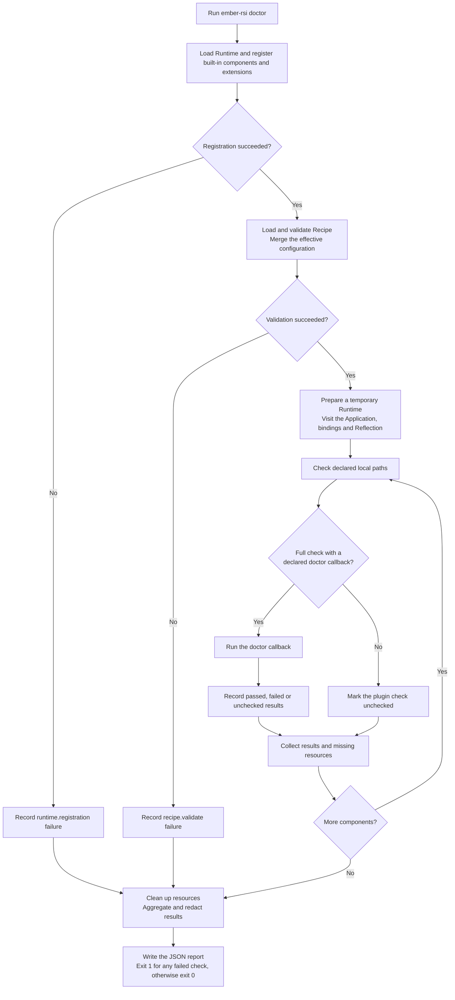

# Diagnose an experiment with doctor

English | [简体中文](doctor_zh.md) · [Getting started](../getting-started.md)

## 1. Purpose

`ember-rsi doctor` checks whether an experiment's configuration, inputs and supported runtime prerequisites are ready before you start it. Use it after preparing a Recipe, changing components, models or credentials, or moving an experiment to another environment.

```sh
ember-rsi doctor my-experiment/recipe.yaml
```

- From a source checkout, run `pnpm build` first. Set the environment variables required by the selected components before running `pnpm ember-rsi doctor my-experiment/recipe.yaml`.
- `doctor` combines Recipe validation with component-specific checks. It can catch missing prompts or baselines, incompatible bindings, proposal model connection failures, and evaluator configuration, runtime or download-route problems reported by the SDK.

For a quick check of the effective configuration and declared local paths, add `--static`.

```sh
ember-rsi doctor my-experiment/recipe.yaml --static
```

## 2. How it works

### Loading and dispatch

The following diagram shows normal command completion.



1. **Load registrations.** The CLI uses the usual Runtime registration to load built-in components, user extensions in `~/.ember-rsi/plugins/<name>/index.mjs` and extensions specified by `--plugin-dir`.
2. **Load the effective Recipe.** `Recipe.load` validates Schemas, bindings, contract compatibility, Policy compilation, budgets and declared Reflection resources.
   - Probes use the configuration produced by merging Policy defaults and Recipe overrides.
   - A loading error produces a failed diagnostic and stops component probes.
3. **Check declared local paths.** For the Application, each effective binding and the configured Reflection implementation, doctor checks local files and directories marked with `x-rsi-path` for existence, type and readability.
4. **Run component checks.** By default, the framework calls `doctor` on each definition that declares it. Unavailable prerequisites can leave dependent checks `unchecked` while independent checks continue. `--static` skips all callbacks, including their model access, instance preparation and SDK probes. The report marks `<binding>.plugin` as `unchecked` when the flag skips a callback or the definition omits it, with a reason for each case.
5. **Clean up and report.** RSI checks use isolated temporary storage, propagate cancellation, release the instances and processes they create, and remove temporary files. Checks can read existing artifacts as inputs. RSI keeps its captures and writes in the temporary Runtime.

### Reading the JSON report

Normal completion writes one JSON report to stdout, including configuration or registration failures:

| Field              | Meaning                                                                                                    |
| ------------------ | ---------------------------------------------------------------------------------------------------------- |
| `recipeId`         | Loaded Recipe ID, or `null` if loading did not succeed.                                                    |
| `summary`          | Counts of `passed`, `failed` and `unchecked` checks.                                                       |
| `checks`           | Individual results with `id`, `status`, optional `binding`, `pluginId`, `reason` and `details`.            |
| `missingResources` | Missing input references, their configuration fields and kinds, and dependent check IDs that were not run. |

Component check IDs start with the binding name. In a full check, a binding named `agent` using Pi produces `agent.model-config` and `agent.model-access`. A different binding name changes the prefix.

| Status      | Interpretation                                                                                                                                                |
| ----------- | ------------------------------------------------------------------------------------------------------------------------------------------------------------- |
| `passed`    | This check established the fact described by its ID and explanation.                                                                                          |
| `failed`    | The check found an error or could not complete a required probe, for example rejected credentials or a request timeout. Read its explanation before retrying. |
| `unchecked` | The check could not establish a conclusion, for example because an earlier prerequisite failed or the selected execution path has no supported diagnostic.    |

Review `unchecked` results even when the exit code is zero. A complete JSON report may be unavailable after interruption or a command usage error.

- `1` means at least one check failed.
- `0` means no check failed, **including reports with unchecked entries**.
- Interruption returns `130`.
- A command usage error, such as omitting the Recipe argument, returns `2`.

## 3. Checks for built-in components

The following 18 built-in implementations declare their own `doctor` callback. Doctor checks the components selected by the effective Recipe.

### Applications and Agents

| Implementation            | Checks performed                                                                                                                                                                                                                                                     |
| ------------------------- | -------------------------------------------------------------------------------------------------------------------------------------------------------------------------------------------------------------------------------------------------------------------- |
| `application.agentbundle` | 1. Check that the target definition, baseline and required files are readable.<br>2. Initialize the application and validate the AgentBundle contents.<br>3. Acquire a temporary instance, read its contents, release it and confirm cleanup.                        |
| `application.kernel`      | 1. Check the target definition, baseline and kernel source files.<br>2. Initialize the application and validate the kernel source structure.<br>3. Acquire a temporary instance, read its source, release it and confirm cleanup.                                    |
| `application.inference`   | 1. Check the target definition and baseline inputs.<br>2. Check the local launch command, working directory and resources, or the remote controller interpreter, script and parameter file.<br>3. Validate the credential environment variables and launch settings. |
| `agent.pi`                | 1. Validate the model, service address, credentials and token limits.<br>2. Connect to the model service from the RSI process and confirm that its model list contains the selected model.                                                                           |
| `agent.codex`             | 1. Check that the Codex command is available and supports native diagnostics.<br>2. Run native diagnostics in an isolated project using the configured model and reasoning level, then read the results.                                                             |

### Proposers, Memory, Reflection and Selectors

| Implementation              | Checks performed                                                                                                                                                                                                                |
| --------------------------- | ------------------------------------------------------------------------------------------------------------------------------------------------------------------------------------------------------------------------------- |
| `proposer.agent`            | 1. Check the selected Agent binding and compatibility.<br>2. Read prompts, guidance, skills and role prompts.<br>3. Prepare an isolated editing project and confirm that these inputs can be assembled.                         |
| `proposer.operator`         | 1. Check the selected Agent binding and compatibility.<br>2. Read the operator task and cases, and validate their identifiers.<br>3. Read stage prompts, external knowledge, retrieval resources and optional hardware context. |
| `proposer.grid`             | 1. Check the parameter path and search-axis names.<br>2. Validate the grid size and confirm that the component can be created and disposed.                                                                                     |
| `proposer.optuna`           | 1. Validate the sampler, search space and constraint-handling settings.<br>2. Run the Python dependency check and verify the required dependency versions.                                                                      |
| `proposer.pareto-evolution` | 1. Validate the prompt-module definitions.<br>2. Check that each module file exists in the local baseline or file-tree artifact.                                                                                                |
| `memory.agent`              | 1. Check the selected Agent binding and compatibility.<br>2. Read prompts, guidance, skills and role prompts.<br>3. Assemble the editing environment in an isolated project.                                                    |
| `reflection.agent`          | 1. Check the selected Agent binding and compatibility.<br>2. Read prompts, guidance, skills and the built-in reviewer prompt.<br>3. Assemble the editing environment in an isolated project.                                    |
| `selector.metric`           | 1. Validate the metric-selection settings.<br>2. Check candidate eligibility conditions and constraint bounds, and confirm that the component can be created and disposed.                                                      |
| `selector.artifact`         | 1. Check the selected Agent binding and compatibility.<br>2. Read selection prompts, guidance, skills and role prompts.<br>3. Prepare an isolated selection project.                                                            |
| `selector.inference`        | 1. Validate the inference selection settings.<br>2. Check constraint bounds and confirm that the component can be created and disposed.                                                                                         |

### Evaluators

All three Evaluators use their configuration adapters to call the installed Evaluator SDK doctor. Configuration and output paths stay in the isolated temporary directory.

| Implementation             | Checks performed                                                                                                                                                                     |
| -------------------------- | ------------------------------------------------------------------------------------------------------------------------------------------------------------------------------------ |
| `evaluator.agentbench`     | 1. Check Application compatibility and prepare the AgentBundle path and selected tasks.<br>2. Pass the evaluation configuration to the SDK for diagnosis.                            |
| `evaluator.inferencebench` | 1. Check Application compatibility and prepare the evaluation configuration with a placeholder inference endpoint.<br>2. Pass the evaluation configuration to the SDK for diagnosis. |
| `evaluator.operatorbench`  | 1. Read the operator task and prepare the evaluation configuration with its first case.<br>2. Pass the evaluation configuration to the SDK for diagnosis.                            |

- The SDK checks Docker, Python, declared local inputs and Ray connection prerequisites based on the configuration. **Network diagnostics download temporary resources. The Docker path also tests image acquisition and `FROM` and `RUN` builds.** The SDK cleans up its probe resources. Downloaded base images may stay cached.
- The SDK's `not-checked` status and `incomplete` network summary map to `unchecked`. Incomplete coverage can cause the SDK to exit with code `1`. After receiving a valid report, RSI determines its own exit code from the check results.

## 4. Connecting custom components

Define and register your component using the plugin guide. Add an optional `doctor` function to the component definition. The call to `registry.registerOperation(definition)` registers the diagnostic capability along with the component. See [Write a plugin](writing-plugins.md).

### Write and declare the diagnostic function

In this example, the existing `configSchema` declares a required string named `inputFile` with the annotation `'x-rsi-path': 'file'`. The common check validates the path. The following `doctor.ts` checks the file contents.

```ts
import { readFile } from 'node:fs/promises';
import type { OperationDoctor } from 'ember-rsi/contracts';

type CustomConfig = { inputFile: string };

export const checkCustom: OperationDoctor<CustomConfig> = async (context) => {
  await context.check('input-content', async (signal) => {
    const text = await readFile(context.binding.config.inputFile, {
      encoding: 'utf8',
      signal,
    });
    if (!text.trim()) throw new Error('inputFile must contain text.');
  });
};
```

Add the diagnostic function to the component definition in its `index.ts` or `index.js`.

```js
import { proposerContract } from 'ember-rsi/contracts';
import { configSchema } from './schema.js';
import { createCustom } from './service.js';
import { checkCustom } from './doctor.js';

export const customDefinition = {
  id: 'proposer.custom',
  contract: proposerContract,
  configSchema,
  create: createCustom,
  doctor: checkCustom, // Optional
};
```

Build the extension, call `registry.registerOperation(customDefinition)` from its `index.mjs`, then load the extension with the CLI.

```sh
ember-rsi doctor my-experiment/recipe.yaml --plugin-dir ./my-extension
```

### Callback contract and lifecycle

Import the public types `OperationDoctor<C>` and `DoctorContext<C>` from `ember-rsi/contracts` or `ember-rsi`. `C` is the component configuration type, available as effective configuration in `context.binding.config`. The callback returns `Promise<void>` and records results through the context.

| Context method                    | Use                                                                                                                                         |
| --------------------------------- | ------------------------------------------------------------------------------------------------------------------------------------------- |
| `check(id, action, options?)`     | Record one check as passed or failed and return a boolean. The action receives its own cancellation signal. Set its limit with `timeoutMs`. |
| `unchecked(id, reason, details?)` | Record work skipped because a prerequisite is unavailable or the execution path is unsupported.                                             |
| `missing(resource)`               | Record a missing input and related check IDs. Use `unchecked` separately for skipped dependent checks.                                      |

- Component registration and Recipe loading retain the callback for the `doctor` command to invoke.
- When a component omits `doctor`, the framework still runs the common checks and marks the component-specific `plugin` check as `unchecked`.
- Keep temporary files in `context.directory` or the isolated Runtime. Pass each check's signal to external operations and clean up the resources the diagnostic creates in `finally`.

## 5. Doctor time limits

Doctor checks bindings sequentially. The command's total duration depends on the checks and cleanup. RSI checks and Evaluator SDK probes have separate timers.

| Operation or check ID                          | Limit                                                                  | Scope                                                                                                                                  |
| ---------------------------------------------- | ---------------------------------------------------------------------- | -------------------------------------------------------------------------------------------------------------------------------------- |
| Common `context.check` checks                  | 60 seconds per check by default                                        | Local paths, configuration and Application verification/acquisition have separate timers; operations within one check share its limit. |
| `agent.codex` `executable` and `doctor`        | 60 seconds each                                                        | CLI help and native doctor help share the `executable` timer; native JSON diagnostics are separate.                                    |
| Pi `model-access` HTTP request                 | 10 seconds per request                                                 | Covers the HTTP request and complete response body within the outer 60-second check.                                                   |
| Optuna `python-dependencies`                   | 60 seconds outside; configured `python.timeoutMs` also applies         | A shorter worker timeout can finish earlier; a longer value cannot extend the enclosing RSI check.                                     |
| Evaluator SDK connectivity and download probes | Per probe, managed by the SDK                                          | The pinned SDK allows 5 seconds for executable and Ray TCP/TLS checks, and 180 seconds for each download network probe.                |
| Evaluator SDK Ray download diagnostics         | 3000 seconds for the node process and 3100 seconds for the coordinator | The node process timer covers probes on that node. The coordinator timer covers result collection.                                     |

Nested limits expire at the first deadline. For Pi, the request's 10 seconds are part of its 60-second check, not an extra allowance. The CLI has no doctor-specific timeout option, and these limits do not come from Recipe experiment budgets. Pi/Codex `config.timeoutMs` applies to real Agent execution; see [Configure Recipes, Targets and components](configuration.md).

An RSI check timeout produces `failed`, meaning the probe could not complete rather than establishing that the plugin is unavailable. The runner waits up to **15 additional seconds** for a cancelled common check to settle; otherwise it records an extra `<binding>.<check ID>.cleanup: failed`. Final Runtime and temporary-directory cleanup are outside that wait, so the command need not return within 60 or 75 seconds.

On Evaluator cancellation, RSI asks the SDK to stop its probes and clean up. The SDK has up to 60 seconds to respond. RSI starts forced process-tree termination when that time expires or when it cannot deliver the cancellation message. Cleanup of Docker daemon resources is unknown after forced termination. The pinned SDK allows 30 seconds to remove probe images. Downloaded base images may stay cached.
