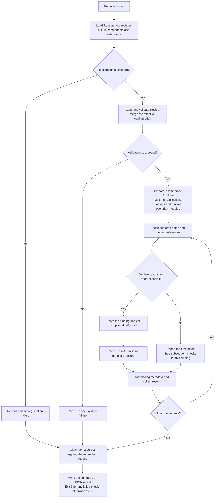

# Diagnose an experiment with doctor

English | [简体中文](doctor_zh.md) · [Getting started](../getting-started.md)

## 1. Purpose

`arsi doctor` checks whether an experiment's configuration, inputs and supported runtime prerequisites are ready before you start it. Use it after preparing a Recipe, changing components, models or credentials, or moving an experiment to another environment.

```sh
arsi doctor my-experiment/recipe.yaml
```

- From a source checkout, run `pnpm build` first. Set the environment variables required by the selected components before running `pnpm arsi doctor my-experiment/recipe.yaml`.
- `doctor` combines Recipe validation with component-specific checks. It can catch missing prompts or baselines, incompatible bindings, proposal model connection failures, and evaluator configuration, runtime or download-route problems reported by the SDK.

## 2. How it works

### Loading and dispatch

The following diagram shows normal command completion.



1. **Load registrations.** The CLI uses the usual Runtime registration to load built-in components, user extensions in `~/.arsi/plugins/<name>/index.mjs` and extensions specified by `--plugin-dir`.
2. **Load the effective Recipe.** `Recipe.load` validates Schemas, bindings, contract compatibility, Policy compilation, budgets and enabled Memory and Reflection resources.
   - Probes use the configuration produced by merging Policy defaults and Recipe overrides.
   - A loading error produces a failed diagnostic and stops component probes.
3. **Check declared prerequisites.** For the Application, each effective binding and each enabled runtime evolution module, doctor checks local files and directories marked with `x-rsi-path` for existence, type and readability. It checks that fields marked with `x-rsi-binding` name Recipe bindings that implement the declared contracts.
4. **Run component checks.** If a declared path or binding reference fails validation, doctor reports that failure and continues with the next binding. When these prerequisites pass, doctor creates a temporary instance, awaits its optional `rsi/doctor` reply, then disposes it. An initialization error fails that binding and other bindings continue. A missing handler leaves the `plugin` check `unchecked`.
5. **Clean up and report.** RSI checks use isolated temporary storage, propagate cancellation, release the instances and processes they create, and remove temporary files. Checks can read existing artifacts as inputs. RSI keeps its captures and writes in the temporary Runtime.

### Reading the summary and JSON report

Within each binding, the first failure stops subsequent checks, which appear as `unchecked`; earlier results are retained and other bindings continue. Counts include all emitted checks. A failed declared prerequisite prevents instance creation and leaves plugin diagnostics `unchecked`.

By default, `doctor` writes a readable summary to stdout with check counts, failures, unchecked checks and available fixes.

For scripts or full probe evidence, request the JSON report.

```sh
arsi doctor my-experiment/recipe.yaml --json
```

The report contains the following fields, including when configuration loading or registration fails.

| Field      | Meaning                                                                                 |
| ---------- | --------------------------------------------------------------------------------------- |
| `recipeId` | Loaded Recipe ID, or `null` if loading did not succeed.                                 |
| `checks`   | Individual results with `id` and `status`. A check may also include scope and evidence. |

Use `checks` to count results by status or find failures. Optional fields include `binding`, `pluginId`, `reason` and `details`. Read `reason` for the error, available fixes or a limitation of the diagnostic scope.

Component check IDs start with the binding name. A binding named `agent` using Pi emits `agent.model-config`, followed by `agent.model-access`; the second item is `unchecked` when model configuration fails. A different binding name changes the prefix.

| Status      | Interpretation                                                                                                                                                 |
| ----------- | -------------------------------------------------------------------------------------------------------------------------------------------------------------- |
| `passed`    | This check established the fact described by its ID and explanation.                                                                                           |
| `failed`    | The check found an error or could not complete a required probe, for example rejected credentials or a request timeout. Read its explanation before retrying.  |
| `unchecked` | The check could not establish a conclusion, for example because a native tool does not support the diagnostic or an endpoint is created only during execution. |

Review unchecked results even when the exit code is zero. Exit codes apply to both output formats. A complete summary or report may be unavailable after interruption or a command usage error.

- `1` means at least one check failed.
- `0` means no check failed, **including reports with unchecked entries**.
- Interruption returns `130`. If interruption occurs during Runtime cleanup and cleanup fails, stderr includes both diagnostics.
- A command usage error, such as omitting the Recipe argument, returns `2`.

## 3. Checks for built-in components

The following built-in implementations provide a `rsi/doctor` handler. Doctor checks the components selected by the effective Recipe.

### Applications and Agents

| Implementation            | Checks performed                                                                                                                                                                                                                                                     |
| ------------------------- | -------------------------------------------------------------------------------------------------------------------------------------------------------------------------------------------------------------------------------------------------------------------- |
| `application.agentbundle` | 1. Check that the target definition, baseline and required files are readable.<br>2. Initialize the application and validate the AgentBundle contents.<br>3. Acquire a temporary instance, read its contents, release it and confirm cleanup.                        |
| `application.kernel`      | 1. Check the target definition, baseline and kernel source files.<br>2. Initialize the application and validate the kernel source structure.<br>3. Acquire a temporary instance, read its source, release it and confirm cleanup.                                    |
| `application.inference`   | 1. Check the target definition and baseline inputs.<br>2. Check the local launch command, working directory and resources, or the remote controller interpreter, script and parameter file.<br>3. Validate the credential environment variables and launch settings. |
| `agent.pi`                | 1. Validate the model, service address, credentials and token limits.<br>2. Connect to the model service from the RSI process and confirm that its model list contains the selected model.                                                                           |
| `agent.codex`             | 1. Check that the Codex command is available and supports native diagnostics.<br>2. Run native diagnostics in an isolated project using the Codex `-c` / `--config` overrides from `options`, then read the results.                                                             |
| `agent.claudecode`        | Check CLI options and native JSON authentication status. Text-only installation diagnostics remain `unchecked`; run `claude doctor` manually. Model access is not verified.                                                                                          |
| `agent.dsh`               | Check CLI options and compose the headless configuration to detect composition errors. This may refresh native caches; dynamic model routes, stored credentials and model access are not verified.                                                                   |
| `agent.opencode`          | Check the V2 CLI version, required options, and composition of native configuration with the RSI read-only Agent. Uses a private instance and may refresh native caches.                                                                                             |

For `application.inference`, Recipe loading checks that `healthcheck.path` and `endpoint.basePath` begin with a single `/`. Remote mode requires paths without query strings or fragments. These rules apply to both `doctor` and `run` before launch.

### Proposers, Memory, Reflection and Selectors

Doctor checks the configurations of enabled runtime evolution modules, the Memory source directory when supplied, and the selected Agent. With no explicit Agent binding it checks the synthesized `_evolutionAgent` binding for the built-in `agent.pi` plugin. Disabled modules skip resource loading.

| Implementation              | Checks performed                                                                                                                                                                                                                |
| --------------------------- | ------------------------------------------------------------------------------------------------------------------------------------------------------------------------------------------------------------------------------- |
| `proposer.agent`            | 1. Check the selected Agent binding and compatibility.<br>2. Read prompts, guidance, skills and role prompts.<br>3. Prepare an isolated editing project and confirm that these inputs can be assembled.                         |
| `proposer.operator`         | 1. Check the selected Agent binding and compatibility.<br>2. Read the operator task and cases, and validate their identifiers.<br>3. Read stage prompts, external knowledge, retrieval resources and optional hardware context. |
| `proposer.grid`             | 1. Check the parameter path, search-axis names and grid size.<br>2. Read the Application baseline file at `config.path` and require a JSON object.                                                                              |
| `proposer.optuna`           | 1. Validate the sampler, search space and constraint-handling settings.<br>2. Read the Application baseline file at `config.path` and require a JSON object.<br>3. Check Python dependencies and their versions.                |
| `proposer.pareto-evolution` | 1. Validate the prompt-module definitions.<br>2. Check that each module file exists in the local baseline or file-tree artifact.                                                                                                |
| `summarizer.operator`       | Check that `promptFile` is readable and contains non-whitespace text.                                                                                                                                                           |
| `memory.agent`              | 1. Check the selected Agent binding and compatibility.<br>2. Read prompts, guidance, skills and role prompts.<br>3. Assemble the editing environment in an isolated project.                                                    |
| `reflection.agent`          | 1. Check the selected Agent binding and compatibility.<br>2. Read prompts, guidance, skills and the built-in reviewer prompt.<br>3. Assemble the editing environment in an isolated project.                                    |
| `selector.metric`           | 1. Validate the metric-selection settings.<br>2. Check candidate eligibility conditions and constraint bounds, and confirm that the component can be created and disposed.                                                      |
| `selector.artifact`         | 1. Check the selected Agent binding and compatibility.<br>2. Read selection prompts, guidance, skills and role prompts.<br>3. Prepare an isolated selection project.                                                            |
| `selector.inference`        | 1. Validate the inference selection settings.<br>2. Check constraint bounds and confirm that the component can be created and disposed.                                                                                         |

### Evaluators

All three Evaluators use their configuration adapters to call the installed Evaluator SDK doctor. Configuration and output paths stay in the isolated temporary directory.

Read `sdk-doctor.details` for native checks and network evidence. `sdk.coverage` and `sdk.network` report prerequisite coverage and network readiness.

| Implementation             | Checks performed                                                                                                                                                                     |
| -------------------------- | ------------------------------------------------------------------------------------------------------------------------------------------------------------------------------------ |
| `evaluator.agentbench`     | 1. Check Application compatibility and prepare the AgentBundle path and selected tasks.<br>2. Pass the evaluation configuration to the SDK for diagnosis.                            |
| `evaluator.inferencebench` | 1. Check Application compatibility and prepare the evaluation configuration with a placeholder inference endpoint.<br>2. Pass the evaluation configuration to the SDK for diagnosis. |
| `evaluator.operatorbench`  | 1. Read the operator task and prepare the evaluation configuration with its first case.<br>2. Pass the evaluation configuration to the SDK for diagnosis.                            |

- The SDK checks Docker, Python, declared local inputs and Ray connection prerequisites based on the configuration. **Network diagnostics download temporary resources. The Docker path also tests image acquisition and `FROM` and `RUN` builds.** The SDK cleans up its probe resources. Downloaded base images may stay cached.
- A native `not-checked` prerequisite leaves `sdk.coverage` unchecked; an `incomplete` network summary leaves `sdk.network` unchecked. Incomplete coverage can cause the SDK to exit with code `1`. After receiving a valid report, RSI determines its own exit code from the check results.

## 4. Connecting custom components

Subscribe to `rsi/doctor` in the component’s `create(config, ctx)`. See [Write a plugin](writing-plugins.md).

### Write the diagnostic handler

Import `OperationDoctor<C>`, `DoctorContext<C>` and `DoctorRule` from `arsi/contracts` or `arsi`.

- Each temporary instance owns its handler. The `doctor` command supplies each binding’s effective configuration.
- When a component has no `rsi/doctor` subscription, the framework still runs the common checks and marks the component-specific `plugin` check as `unchecked`.

| Type                 | Purpose                                                                                                                                         |
| -------------------- | ----------------------------------------------------------------------------------------------------------------------------------------------- |
| `OperationDoctor<C>` | Returns `DoctorRule[]` or `Promise<DoctorRule[]>`.                                                                                              |
| `DoctorContext<C>`   | Effective configuration, isolated Runtime, temporary directory and command cancellation.                                                        |
| `DoctorRule`         | `id`, a lazy boolean `check(signal)`, and failure/fix `reason`. Omit `check` for unsupported diagnosis. Optional `details` stores observations. |

- `C` is the component configuration type. Here `schema.ts` exports `type CustomConfig = { inputFile: string }`, so TypeScript infers `context.binding.config.inputFile` as `string`.

In this example, the existing `configSchema` declares a required string named `inputFile` with the annotation `'x-rsi-path': 'file'`. The common check validates the path. The following `doctor.ts` checks the file contents.

```ts
import { readFile } from 'node:fs/promises';
import type { DoctorContext, DoctorRule } from 'arsi/contracts';
import type { CustomConfig } from './schema.js';

export function doctor(context: DoctorContext<CustomConfig>): DoctorRule[] {
  async function isInputReady(signal: AbortSignal): Promise<boolean> {
    const text = await readFile(context.binding.config.inputFile, {
      encoding: 'utf8',
      signal,
    });
    return Boolean(text.trim());
  }

  return [
    {
      id: 'input-content',
      check: isInputReady,
      reason:
        'inputFile is empty or unreadable; restore its contents or correct inputFile.',
    },
    {
      id: 'remote-service',
      reason: 'This component does not diagnose the remote service.',
    },
  ];
}
```

Forward each check's supplied signal to I/O and release resources after failure or cancellation. A false result uses the definition's `reason`; an error or timeout adds diagnostic context. Optional `timeoutMs` overrides the default check limit; `null` delegates time limits to the native workflow.

In `service.ts`, type the factory parameter as `ctx: RuntimeContext<CustomConfig>`. Import `RuntimeContext` from `arsi/contracts` and subscribe to `doctor` from `./doctor.js` inside the factory. The extension entry point registers `customDefinition` with `registry.registerOperation(customDefinition)`.

```ts
ctx.event.on('rsi/doctor', doctor);
```

Build the extension and load its `index.mjs` with the CLI.

```sh
arsi doctor my-experiment/recipe.yaml --plugin-dir ./my-extension
```

## 5. Doctor time limits

Doctor checks bindings sequentially. The command's total duration depends on the checks and cleanup. RSI checks and Evaluator SDK probes have separate timers.

| Operation or check ID                               | Limit                                                                  | Scope                                                                                                                                                  |
| --------------------------------------------------- | ---------------------------------------------------------------------- | ------------------------------------------------------------------------------------------------------------------------------------------------------ |
| Framework check execution                           | 60 seconds per check by default                                        | Local paths, SDK configuration preparation and Application verification/acquisition have separate timers; operations within one check share its limit. |
| `agent.codex` `executable` and `doctor`             | 60 seconds each                                                        | CLI help and native doctor help share the `executable` timer; native JSON diagnostics are separate.                                                    |
| `agent.claudecode` / `agent.dsh` / `agent.opencode` | 60 seconds per check                                                   | CLI compatibility, Claude authentication and DSH/OpenCode configuration.                                                                               |
| Pi `model-access` HTTP request                      | 10 seconds per request                                                 | Covers the HTTP request and complete response body within the outer 60-second check.                                                                   |
| Optuna `python-dependencies`                        | 60 seconds outside; configured `python.timeoutMs` also applies         | A shorter worker timeout can finish earlier; a longer value cannot extend the enclosing RSI check.                                                     |
| Evaluator SDK connectivity and download probes      | Per probe, managed by the SDK                                          | The pinned SDK allows 5 seconds for executable and Ray TCP/TLS checks, and 180 seconds for each download network probe.                                |
| Evaluator SDK Ray download diagnostics              | 3000 seconds for the node process and 3100 seconds for the coordinator | The node process timer covers probes on that node. The coordinator timer covers result collection.                                                     |

Nested limits expire at the first deadline. For Pi, the request's 10 seconds are part of its 60-second check, not an extra allowance. The CLI has no doctor-specific timeout option, and these limits do not come from Recipe experiment budgets. Pi/Codex/Claude Code/DSH `config.timeoutMs` applies to real Agent execution; see [Configure Recipes, Targets and components](configuration.md).

An RSI check timeout produces `failed` because the probe did not finish. The runner waits up to **15 additional seconds** for a cancelled probe to settle. If that wait expires after a timeout, the same check's reason says cleanup could not be confirmed. Final Runtime and temporary-directory cleanup have their own duration.

On Evaluator cancellation, RSI asks the SDK to stop its probes and clean up. The SDK has up to 60 seconds to respond. RSI starts forced process-tree termination when that time expires or when it cannot deliver the cancellation message. Cleanup of Docker daemon resources is unknown after forced termination. The pinned SDK allows 30 seconds to remove probe images. Downloaded base images may stay cached.
