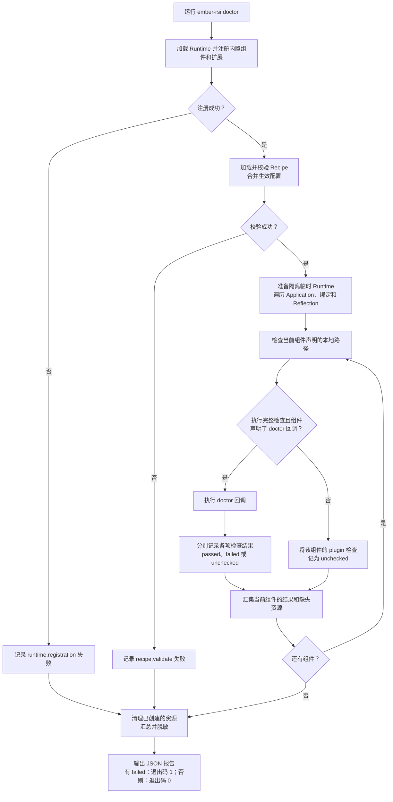

# 使用 doctor 诊断实验

[English](doctor.md) | 简体中文 · [入门指南](../getting-started_zh.md)

## 1. 简介

`ember-rsi doctor` 用于在启动实验前，检查实验配置、输入和已支持的运行前提是否就绪。准备 Recipe、更换组件、模型或凭据，或迁移实验环境后都可以运行。

```sh
ember-rsi doctor my-experiment/recipe.yaml
```

- 在源码仓库中，完成 `pnpm build` 后使用 `pnpm ember-rsi doctor my-experiment/recipe.yaml`，运行前设置所选组件需要的环境变量。
- `doctor` 将 Recipe 校验与组件专用检查结合起来，可以发现提示词或基线缺失、绑定不兼容、提案侧模型连接失败，以及 SDK 报告的评测配置、运行前提或下载路线问题。

- 只需快速检查生效配置和已声明的本地路径时，可以加上 `--static`。

## 2. doctor 的机制简介

### 加载与分发

正常完成时的检查流程如下：



1. **加载注册。** CLI 沿用正常 Runtime 注册流程，加载内置组件、`~/.ember-rsi/plugins/<name>/index.mjs` 中的用户扩展，以及 `--plugin-dir` 指定的扩展。
2. **加载生效 Recipe。** `Recipe.load` 校验 Schema、绑定、契约兼容性、Policy 编译、预算和已声明的 Reflection 资源。
   - 探测使用合并 Policy 默认配置与 Recipe 覆盖后的配置。
   - 加载失败时输出失败诊断，不再执行组件探测。
3. **检查已声明的本地路径。** 对 Application、每个生效绑定及已配置的 Reflection 实现，检查 Schema 中用 `x-rsi-path` 标记的本地文件或目录是否存在、类型是否正确、是否可读。
4. **执行组件检查。** 默认情况下，框架调用组件定义上声明的 `doctor` 函数。前提不可用时，依赖检查可记为 `unchecked`，独立检查继续运行。`--static` 跳过所有回调，省去回调中的模型访问、实例准备和 SDK 探测。使用该选项或组件省略回调时，报告将 `<binding>.plugin` 记为 `unchecked` 并说明原因。
5. **清理并输出。** RSI 检查使用隔离临时存储，传递取消信号，释放自己创建的实例与进程，并删除临时文件。原有 artifacts 可作为输入读取，RSI 产生的捕获与写入留在临时 Runtime 内。

### 运行结果

正常完成时向 stdout 输出一份 JSON 报告，包括配置或注册失败的情况：

| 字段               | 含义                                                                               |
| ------------------ | ---------------------------------------------------------------------------------- |
| `recipeId`         | 已加载的 Recipe ID；未能成功加载时为 `null`。                                      |
| `summary`          | `passed`、`failed`、`unchecked` 三类检查的数量。                                   |
| `checks`           | 每项结果的 `id`、`status`，以及可选的 `binding`、`pluginId`、`reason`、`details`。 |
| `missingResources` | 缺失输入的引用、配置字段、资源种类，以及因此未执行的依赖检查 ID。                  |

组件检查 ID 以绑定名开头。完整检查时，名为 `agent` 的 Pi 绑定会产生 `agent.model-config` 和 `agent.model-access`。更换绑定名后，前缀也随之变化。

| 状态        | 如何理解                                                                           |
| ----------- | ---------------------------------------------------------------------------------- |
| `passed`    | 该项检查已证实其 ID 和说明所描述的事实。                                           |
| `failed`    | 发现错误，或必须执行的探测未能完成，例如密钥被拒绝或请求超时。应先阅读原因再重试。 |
| `unchecked` | 无法建立结论，例如前提检查失败，或所选执行路径没有相应诊断。                       |

退出码如下，注意后两类情况不保证有完整 JSON 报告。即使退出码为零，也需要阅读 `unchecked` 项：

- `1` 表示至少有一项失败；
- `0` 表示没有失败项，**其中可以包含未检查项**。
- 中断返回 `130`；
- 省略 Recipe 参数等命令用法错误返回 `2`。

## 3. doctor 针对内置组件都检查什么

以下 18 个内置实现都在自己的定义上声明 `doctor`。doctor 检查生效 Recipe 中选中的组件。

### Application 与 Agent

| 实现                      | 实际检查                                                                                                                                                      |
| ------------------------- | ------------------------------------------------------------------------------------------------------------------------------------------------------------- |
| `application.agentbundle` | 1. 检查目标定义、基线和必需文件是否可读。<br>2. 初始化应用并校验 AgentBundle 内容。<br>3. 获取临时实例，读取内容，释放实例并确认清理完成。                    |
| `application.kernel`      | 1. 检查目标定义、基线和内核源文件。<br>2. 初始化应用并校验内核源码结构。<br>3. 获取临时实例，读取源码，释放实例并确认清理完成。                               |
| `application.inference`   | 1. 检查目标定义和基线输入。<br>2. 检查本地启动命令、工作目录和资源，或远程控制脚本的解释器、脚本及参数文件。<br>3. 检查凭据所需的环境变量和启动配置是否合法。 |
| `agent.pi`                | 1. 校验模型、服务地址、密钥和 token 限制的配置。<br>2. 从 RSI 进程连接模型服务，确认模型列表包含所选模型。                                                    |
| `agent.codex`             | 1. 检查 Codex 命令是否可用、是否支持原生诊断。<br>2. 按所配模型和思考等级，在隔离项目中运行原生诊断并读取结果。                                               |

### Proposer、Memory、Reflection 与 Selector

| 实现                        | 实际检查                                                                                                                                       |
| --------------------------- | ---------------------------------------------------------------------------------------------------------------------------------------------- |
| `proposer.agent`            | 1. 检查所选 Agent 的绑定和兼容性。<br>2. 读取提示词、指导、Skill 和角色提示词。<br>3. 准备隔离编辑项目，确认这些输入可以正确装配。             |
| `proposer.operator`         | 1. 检查所选 Agent 的绑定和兼容性。<br>2. 读取算子任务及用例，核对任务与用例标识。<br>3. 读取阶段提示词、外部知识、检索所需资源及可选硬件说明。 |
| `proposer.grid`             | 1. 检查待调参数的路径和搜索轴名称。<br>2. 检查网格规模，并确认组件可以创建和释放。                                                             |
| `proposer.optuna`           | 1. 校验采样器、搜索空间和约束处理配置。<br>2. 运行 Python 依赖检查，确认依赖版本符合要求。                                                     |
| `proposer.pareto-evolution` | 1. 检查提示词模块定义是否合法。<br>2. 检查各模块文件是否存在于本地基线或文件树制品中。                                                         |
| `memory.agent`              | 1. 检查所选 Agent 的绑定和兼容性。<br>2. 读取提示词、指导、Skill 和角色提示词。<br>3. 在隔离项目中装配编辑环境。                               |
| `reflection.agent`          | 1. 检查所选 Agent 的绑定和兼容性。<br>2. 读取提示词、指导、Skill 和内置评审角色提示词。<br>3. 在隔离项目中装配编辑环境。                       |
| `selector.metric`           | 1. 校验指标选择配置。<br>2. 检查候选资格条件和约束上下界，并确认组件可以创建和释放。                                                           |
| `selector.artifact`         | 1. 检查所选 Agent 的绑定和兼容性。<br>2. 读取选择提示词、指导、Skill 和角色提示词。<br>3. 准备隔离的选择项目。                                 |
| `selector.inference`        | 1. 校验推理选择配置。<br>2. 检查约束上下界，并确认组件可以创建和释放。                                                                         |

### Evaluator

三个 Evaluator 都通过各自的配置适配器调用已安装的 Evaluator SDK doctor。配置与输出路径位于隔离的临时目录。

| 实现                       | 实际检查                                                                                        |
| -------------------------- | ----------------------------------------------------------------------------------------------- |
| `evaluator.agentbench`     | 1. 核对 Application 兼容性，准备 AgentBundle 路径和选中的任务。<br>2. 将评测配置交给 SDK 检查。 |
| `evaluator.inferencebench` | 1. 核对 Application 兼容性，用占位推理端点准备评测配置。<br>2. 将评测配置交给 SDK 检查。        |
| `evaluator.operatorbench`  | 1. 读取算子任务，使用首个用例准备评测配置。<br>2. 将评测配置交给 SDK 检查。                     |

- SDK 根据配置检查 Docker、Python、声明的本地输入及 Ray 连接前提。**网络诊断会实际下载临时资源，Docker 路径还会测试镜像获取和 `FROM`、`RUN` 构建。** SDK 负责清理探测资源，已下载的基础镜像可能留在缓存中。
- SDK 的 `not-checked` 和网络汇总的 `incomplete` 映射为 `unchecked`。SDK 可以因覆盖不完整而返回退出码 `1`。收到有效报告后，RSI 根据检查结果决定自己的退出码。

## 4. 自定义组件如何接入 doctor

按[编写插件](writing-plugins_zh.md)定义并注册组件。在组件定义上添加可选的 `doctor` 函数，检测能力会随 `registry.registerOperation(definition)` 一起注册。

### 编写并声明检测函数

示例在已有 `configSchema` 中将字符串 `inputFile` 声明为必填字段，并用 `'x-rsi-path': 'file'` 标记本地文件。通用检查负责验证路径，下面的 `doctor.ts` 检查文件内容。

```ts
import { readFile } from 'node:fs/promises';
import type { OperationDoctor } from 'ember-rsi/contracts';

type CustomConfig = { inputFile: string };

export const checkCustom: OperationDoctor<CustomConfig> = async (context) => {
  await context.check('input-content', async (signal) => {
    const text = await readFile(context.binding.config.inputFile, {
      encoding: 'utf8',
      signal,
    });
    if (!text.trim()) throw new Error('inputFile must contain text.');
  });
};
```

在组件的 `index.ts` 或 `index.js` 中，将检测函数加入组件定义。

```js
import { proposerContract } from 'ember-rsi/contracts';
import { configSchema } from './schema.js';
import { createCustom } from './service.js';
import { checkCustom } from './doctor.js';

export const customDefinition = {
  id: 'proposer.custom',
  contract: proposerContract,
  configSchema,
  create: createCustom,
  doctor: checkCustom, // 可选
};
```

构建扩展，在扩展的 `index.mjs` 中调用 `registry.registerOperation(customDefinition)`，再通过 CLI 加载扩展。

```sh
ember-rsi doctor my-experiment/recipe.yaml --plugin-dir ./my-extension
```

### 回调约定与生命周期

从 `ember-rsi/contracts` 或 `ember-rsi` 导入公开类型 `OperationDoctor<C>` 和 `DoctorContext<C>`。`C` 是组件配置类型，生效配置通过 `context.binding.config` 读取。回调返回 `Promise<void>`，通过上下文记录结果。

| 上下文方法                        | 用途                                                                                       |
| --------------------------------- | ------------------------------------------------------------------------------------------ |
| `check(id, action, options?)`     | 记录一项检查的通过或失败并返回布尔值。操作接收自己的取消信号，`timeoutMs` 可设置单项时限。 |
| `unchecked(id, reason, details?)` | 记录因前提缺失或执行路径未支持而跳过的检查。                                               |
| `missing(resource)`               | 记录缺失输入及相关检查 ID。另用 `unchecked` 记录跳过的依赖检查。                           |

- 组件注册和 Recipe 加载负责保留回调，`doctor` 命令才会调用它。
- 省略 `doctor` 时，框架仍执行通用检查，并将组件专用的 `plugin` 项标为 `unchecked`。
- 临时文件放在 `context.directory` 或隔离 Runtime 中，外部操作使用单项检查的信号，脚本在 `finally` 中清理自己创建的资源。

## 5. doctor 的时间限制

doctor 按顺序检查各个绑定。命令总耗时取决于各项检查与清理。RSI 检查和 Evaluator SDK 探针各自计时。

| 操作或检查 ID                           | 时限                                               | 计时范围                                                                         |
| --------------------------------------- | -------------------------------------------------- | -------------------------------------------------------------------------------- |
| 通用 `context.check` 检查               | 默认每项 60 秒                                     | 本地路径、配置、Application 验证与获取各自计时，同一项内的多个操作共用时限。     |
| `agent.codex` 的 `executable`、`doctor` | 各 60 秒                                           | CLI 帮助与原生 doctor 帮助共用 `executable` 时限，原生 JSON 诊断另算一项。       |
| Pi 的 `model-access` HTTP 请求          | 每次请求 10 秒                                     | 包含 HTTP 请求和完整响应正文读取，位于外层 60 秒检查内。                         |
| Optuna 的 `python-dependencies`         | 外层 60 秒，同时受已配置的 `python.timeoutMs` 约束 | 更短的 worker 时限可提前结束，更长的值不能延长外层 RSI 检查。                    |
| Evaluator SDK 的连通性与下载探针        | 按 SDK 单项计时                                    | 当前固定 SDK 给可执行程序检查与 Ray TCP/TLS 检查 5 秒，每项下载网络探针 180 秒。 |
| Evaluator SDK 的 Ray 下载诊断           | 节点进程 3000 秒，协调端等待 3100 秒               | 节点进程的计时覆盖该节点的探测，协调端计时覆盖结果收集。                         |

嵌套时限以先到期者为准。Pi 请求自己的 10 秒包含在外层 60 秒中，不能额外相加。CLI 没有 doctor 专用的超时参数，这些时限也不取自 Recipe 的实验预算。Pi/Codex 的 `config.timeoutMs` 用于真实 Agent 执行，参见[配置 Recipe、Target 与组件](configuration_zh.md)。

RSI 检查超时会记为 `failed`，说明探测未完成，不能据此认定插件不可用。通用检查取消后，runner 最多再等待 **15 秒**使其结束；否则额外记录 `<绑定名>.<检查 ID>.cleanup: failed`。最终 Runtime 与临时目录清理不受该等待统一覆盖，因此命令不保证在 60 秒或 75 秒内返回。

Evaluator 取消时，RSI 请求 SDK 结束探测并清理资源。SDK 最长有 60 秒响应。超时或取消消息无法送达时，RSI 开始强制终止进程树，此时 Docker daemon 所有资源的清理状态仍为未知。当前固定 SDK 给删除探测镜像的操作 30 秒。下载的基础镜像可能留在缓存中。
