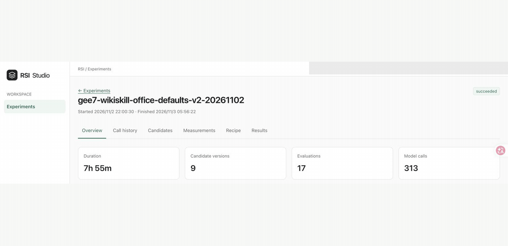

# Run and inspect experiments

English | [简体中文](running-experiments_zh.md) · [Getting started](../getting-started.md)

This guide explains how to validate, run, inspect, cancel, and resume experiments and troubleshoot them through the CLI and dashboard.

Run commands from the workspace that should own the experiment's `.rsi/` directory. Recipe resource paths resolve against their declaring files; the default data store follows the process's working directory. Separate CLI and dashboard processes observe the same store when launched from the same workspace.

## CLI commands

Use `arsi --help` to list commands and `arsi <command> --help` for a command's syntax. From a source checkout without a global install, use `pnpm arsi`.

| Command                                     | Purpose                                                                                                                                   |
| ------------------------------------------- | ----------------------------------------------------------------------------------------------------------------------------------------- |
| `arsi catalog`                         | List registered plugin and Policy IDs.                                                                                                    |
| `arsi list plugins`                    | Inspect plugin descriptions, contracts, Schemas, and compatible Policy bindings.                                                          |
| `arsi list policies`                   | Inspect Policy descriptions, Schemas, requirements, and compatible plugins.                                                               |
| `arsi doctor <recipe.yaml>`            | Check effective configuration, local resources and runtime prerequisites without running the experiment.                                  |
| `arsi run <recipe.yaml>`               | Start or resume an experiment and persist its records.                                                                                    |
| `arsi list`                            | List saved experiments.                                                                                                                   |
| `arsi show <experiment-id>`            | Print saved experiment status, output, and error information.                                                                             |
| `arsi cancel <experiment-id>`          | Send a cancellation request to the specified experiment.                                                                                  |
| `arsi dashboard`                       | Serve a local web dashboard for inspecting experiments.                                                                                   |
| `arsi reflection list [experiment-id]` | List persisted revisions, optionally for one experiment.                                                                                  |
| `arsi reflection show <revisionID>`    | Inspect revision content and planned resource changes.                                                                                    |
| `arsi reflection apply <revisionID>`   | Write the snapshot to its recorded user-resource paths; see the [Reflection rules](reflection.md#apply-a-revision-to-future-experiments). |
| `arsi help [command]`                  | Show the command list or help for a specific command.                                                                                     |

## CLI parameters

The basic syntax is shown below. Required positional arguments appear in the command table above.

```text
arsi [global options] <command> [arguments] [command options]
```

### Global options

These options apply across commands:

| Option                     | Description                                                                                                                                                                                                                                                        |
| -------------------------- | ------------------------------------------------------------------------------------------------------------------------------------------------------------------------------------------------------------------------------------------------------------------ |
| `-h, --help`               | Display help and exit. `arsi --help` lists commands; `arsi <command> --help` shows that command's parameters.                                                                                                                                            |
| `--plugin-dir <directory>` | Load custom plugins and Policies from a directory. Repeat the option for multiple directories; see [plugin registration](writing-plugins.md#step-2-register-the-plugin) and [Policy registration and Recipe configuration](writing-policies.md#register-a-policy). |

### Command-specific options

| Command     | Option                 | Description                                                                           |
| ----------- | ---------------------- | ------------------------------------------------------------------------------------- |
| `run`       | `--id <experiment-id>` | Set the experiment ID. New experiments generate one if omitted; resuming requires it. |
| `run`       | `--resume`             | Resume from saved state; requires `--id`. Omitting it starts a new experiment.        |
| `dashboard` | `--port <port>`        | Set the listening port. Defaults to `4317`; accepts values from `1` to `65535`.       |

## Validate and start

For example, validate and start an experiment with:

```sh
arsi doctor my-experiment/recipe.yaml
arsi run my-experiment/recipe.yaml --id terminal-skills-01
```

- `doctor` checks the Recipe, plugin configuration, contract compatibility, Policy compilation and declared Reflection resources, then calls the optional `doctor` capability on each effective component definition. Its single JSON report contains `recipeId`, `summary`, `checks` and `missingResources`.
  - Statuses are `passed`, `failed` and `unchecked`.
  - For the diagnostic flow, report interpretation, built-in checks and custom-component integration, see the [doctor guide](doctor.md).

Inspect progress from another terminal in the same workspace:

```sh
arsi list
arsi show terminal-skills-01
```

## Read results and evidence

Facts and execution records live in `.rsi/facts/`, immutable artifacts in `.rsi/artifacts/`, and experiment-specific working resources in `.rsi/experiments/<experiment-id>/`.

- Preserve the store and original resource files when resuming.

## Cancellation and resume

```sh
arsi cancel terminal-skills-01
arsi show terminal-skills-01
```

A cancellation request does not stop all work immediately. Runtime propagates the cancellation signal and cleans up its own resources. Check the final status and cleanup records.

- Pressing Ctrl+C in the terminal running the CLI also sends a cancellation signal.

To resume, use the same workspace, original Recipe path, experiment ID, and required extensions:

```sh
arsi run my-experiment/recipe.yaml --id terminal-skills-01 --resume
```

Runtime restores locked definitions, budget usage, effective revisions, call receipts, and checkpoints, and rejects incompatible changes.

- Resume does not reset counters or the experiment's start time; a configured elapsed-wall budget includes downtime.

For `agent.pi`, a failed root call can resume after a permanent HTTP rejection
(400, 401, 403, 404, or 422) only when its immutable project snapshot and complete
attempt diagnostics prove that no model output or tools ran. Keep the receipts
and `diagnostics.jsonl`: missing or incomplete evidence, delegated calls, partial
output, tool activity, and uncertain outcomes remain blocked for inspection.
The Manager restores the root project before replay and retains all budget usage.

## Dashboard

```sh
arsi dashboard --port <port>
```

Run from an experiment workspace that already contains `.rsi/`. The web dashboard displays experiments, summaries, candidates, diffs, measurements, calls, Agent traces, results, and charts, as shown below.

Measurement details show each recorded item's full identifier, subject kind, status, coverage, and metrics. Failed, cancelled, and unknown items show no valid score rather than a numeric result. Missing item evidence is reported explicitly; a successful zero score remains zero.
Metrics that share a display label include their recorded metric names so distinct values remain identifiable.

- Start, resume, and cancel experiments through the CLI.
- Harness results include a Delivered column linked to the measurement returned by the saved selection, with its stage, status, and coverage. Its average uses only available scores from recorded deliveries; unselected higher scores are not substituted, and missing selections show “Not recorded”.
- The development frontend proxies `/api` to port 4317 by default.
- Results for Policies without a specialized report include recorded evaluations before a final output is available, and retain the evaluation history after completion. Final candidates still come only from saved output references. Evaluation lists show status and coverage; failed or interrupted measurements do not supply a final score.
- Results also display the experiment's recorded error when execution fails. An experiment that has ended without a final output is shown as having no recorded final result, while its evaluations remain available.



## Troubleshooting

| Symptom                                                           | Check                                                                                                                                                                       |
| ----------------------------------------------------------------- | --------------------------------------------------------------------------------------------------------------------------------------------------------------------------- |
| Unknown plugin, Policy, or undeclared binding                     | Inspect the current catalog, load the extension in this process, and match the Policy's `require`. File presence alone does not register it.                                |
| Budget exceeded or request timed out                              | Distinguish operation/evaluator/model counters, wall time, individual request time, full Agent time, and benchmark time. See [limits](configuration.md#limits-and-budgets). |
| Dashboard reports a missing `.rsi` or shows different experiments | Start it from the original experiment workspace and use the same data store.                                                                                                |
| Memory failed or Reflection was rejected                          | Inspect saved reasons and subsequent flow. The experiment can continue with the previous experience or guidance after a learning failure.                                   |
