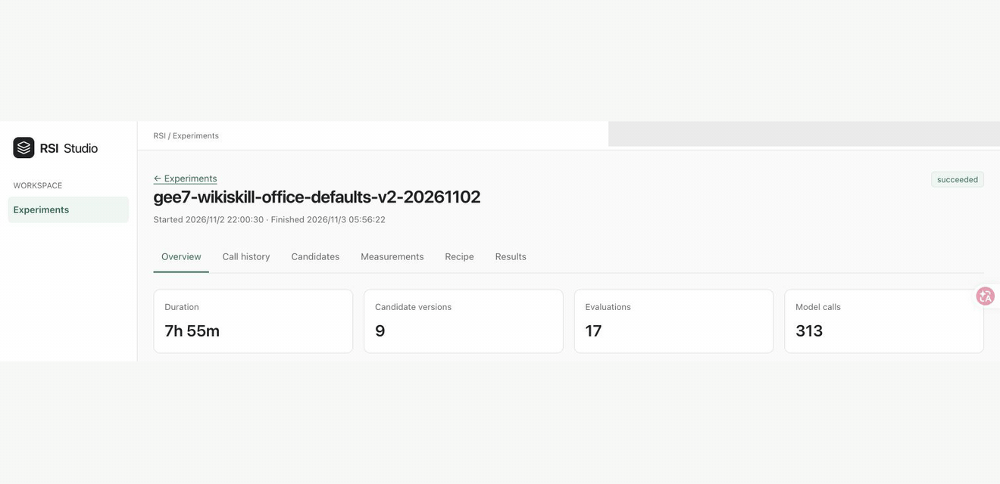

# Run and inspect experiments

English | [简体中文](running-experiments_zh.md) · [Getting started](../getting-started.md)

This guide explains how to validate, run, inspect, cancel, and resume experiments and troubleshoot them through the CLI and dashboard.

Run commands from the workspace that should own the experiment's `.rsi/` directory. Recipe resource paths resolve against their declaring files; the default data store follows the process's working directory. Separate CLI and dashboard processes observe the same store when launched from the same workspace.

## CLI commands

Use `ember-rsi --help` to list commands and `ember-rsi <command> --help` for a command's syntax. From a source checkout without a global install, use `pnpm ember-rsi`.

| Command                                     | Purpose                                                                                                                                   |
| ------------------------------------------- | ----------------------------------------------------------------------------------------------------------------------------------------- |
| `ember-rsi catalog`                         | List registered plugin and Policy IDs.                                                                                                    |
| `ember-rsi list plugins`                    | Inspect plugin descriptions, contracts, Schemas, and compatible Policy bindings.                                                          |
| `ember-rsi list policies`                   | Inspect Policy descriptions, Schemas, requirements, and compatible plugins.                                                               |
| `ember-rsi doctor <recipe.yaml>`            | Check effective configuration, local resources and runtime prerequisites without running the experiment.                                  |
| `ember-rsi run <recipe.yaml>`               | Start or resume an experiment and persist its records.                                                                                    |
| `ember-rsi list`                            | List saved experiments.                                                                                                                   |
| `ember-rsi show <experiment-id>`            | Print saved experiment status, output, and error information.                                                                             |
| `ember-rsi cancel <experiment-id>`          | Send a cancellation request to the specified experiment.                                                                                  |
| `ember-rsi dashboard`                       | Serve a local web dashboard for inspecting experiments.                                                                                   |
| `ember-rsi reflection list [experiment-id]` | List persisted revisions, optionally for one experiment.                                                                                  |
| `ember-rsi reflection show <revisionID>`    | Inspect revision content and planned resource changes.                                                                                    |
| `ember-rsi reflection apply <revisionID>`   | Write the snapshot to its recorded user-resource paths; see the [Reflection rules](reflection.md#apply-a-revision-to-future-experiments). |
| `ember-rsi help [command]`                  | Show the command list or help for a specific command.                                                                                     |

## CLI parameters

The basic syntax is shown below. Required positional arguments appear in the command table above.

```text
ember-rsi [global options] <command> [arguments] [command options]
```

### Global options

These options apply across commands:

| Option                     | Description                                                                                                                                                                                                                                                        |
| -------------------------- | ------------------------------------------------------------------------------------------------------------------------------------------------------------------------------------------------------------------------------------------------------------------ |
| `-h, --help`               | Display help and exit. `ember-rsi --help` lists commands; `ember-rsi <command> --help` shows that command's parameters.                                                                                                                                            |
| `--plugin-dir <directory>` | Load custom plugins and Policies from a directory. Repeat the option for multiple directories; see [plugin registration](writing-plugins.md#step-2-register-the-plugin) and [Policy registration and Recipe configuration](writing-policies.md#register-a-policy). |

### Command-specific options

| Command     | Option                 | Description                                                                           |
| ----------- | ---------------------- | ------------------------------------------------------------------------------------- |
| `run`       | `--id <experiment-id>` | Set the experiment ID. New experiments generate one if omitted; resuming requires it. |
| `run`       | `--resume`             | Resume from saved state; requires `--id`. Omitting it starts a new experiment.        |
| `dashboard` | `--port <port>`        | Set the listening port. Defaults to `4317`; accepts values from `1` to `65535`.       |

## Validate and start

For example, validate and start an experiment with:

```sh
ember-rsi doctor my-experiment/recipe.yaml
ember-rsi run my-experiment/recipe.yaml --id terminal-skills-01
```

- `doctor` checks the Recipe, plugin configuration, contract compatibility, Policy compilation and declared Reflection resources, then calls the optional `doctor` capability on each effective component definition. Its single JSON report contains `recipeId`, `summary`, `checks` and `missingResources`.
  - Statuses are `passed`, `failed` and `unchecked`.
  - For the diagnostic flow, report interpretation, built-in checks and custom-component integration, see the [doctor guide](doctor.md).

Inspect progress from another terminal in the same workspace:

```sh
ember-rsi list
ember-rsi show terminal-skills-01
```

## Read results and evidence

Facts and execution records live in `.rsi/facts/`, immutable artifacts in `.rsi/artifacts/`, and experiment-specific working resources in `.rsi/experiments/<experiment-id>/`.

- Preserve the store and original resource files when resuming.

## Cancellation and resume

```sh
ember-rsi cancel terminal-skills-01
ember-rsi show terminal-skills-01
```

A cancellation request does not stop all work immediately. Runtime propagates the cancellation signal and cleans up its own resources. Check the final status and cleanup records.

- Pressing Ctrl+C in the terminal running the CLI also sends a cancellation signal.

To resume, use the same workspace, original Recipe path, experiment ID, and required extensions:

```sh
ember-rsi run my-experiment/recipe.yaml --id terminal-skills-01 --resume
```

Runtime restores locked definitions, budget usage, effective revisions, call receipts, and checkpoints, and rejects incompatible changes.

- Resume does not reset counters or the experiment's start time; a configured elapsed-wall budget includes downtime.

## Dashboard

```sh
ember-rsi dashboard --port <port>
```

Run from an experiment workspace that already contains `.rsi/`. The web dashboard displays experiments, summaries, candidates, diffs, measurements, calls, Agent traces, results, and charts, as shown below.

- Start, resume, and cancel experiments through the CLI.
- The development frontend proxies `/api` to port 4317 by default.



### Inspect Policy structure

Open an experiment and select **Policy** to inspect its initial saved Policy and Recipe definition. The view identifies the Policy and saved-definition digest. Editing local source files does not change this snapshot. The view is read-only: it does not run plugins, restore resources, or fetch the contents of referenced files.

- **Flow** opens first, with top-level steps between **Policy Input** and **Policy Output**. Select a node to inspect its declaration and saved configuration. Use the separate expand button on a step to reveal a loop, collection body, or branch. Nested containers stay collapsed until expanded.
- In a container's details, expand the collapsed `steps` group to see each child step ID on its own row. Click an ID to reveal the corresponding node in **Flow**.
- **Flow** previews values that can be resolved from the saved configuration, including known ranges with their item counts. **Flow** and **Data** describe built-in expression operations in plain English. Expand **Nested operations** to see their operands and use the information icon to read the original expression.
- Select a linked value or expression to highlight its dependencies in **Data**. **Policy Input** links both Policy defaults and saved Recipe input expressions. ForEach **Item key** is shown in Data details.
- For a state write expression, **Focused** also highlights the written field and the nodes that declare reads of that field, including **Policy Output** when applicable.
- When an expression reads a state field, **Focused** highlights the matching initial state inputs and declared writes. A write to a parent field is included when the expression reads a nested field.
- **Data** shows grouped sources, steps, and outputs from left to right, with connections attached to fields or expression locations. Dashed lines show dynamic access to a known collection or object boundary.
- The detail panel shows the Policy ID and snapshot digest above the declaration and saved configuration. Expand nested objects and lists to inspect their fields and items. Hover over or focus the information icon beside `type` for its meaning.
- **Flow** and **Data** use the same symbols and bold type labels for steps. Data sources have their own symbols. The diamond marks a plugin call. In its details, select the `use` value to jump to **Saved effective binding**. Expand **Input** and select a linked expression to highlight its field and connections in **Data**.
- Switching to **Data** with a step or Policy endpoint selected opens **Focused** and fits the graph to the canvas. **Focused** keeps **Policy Input** and **Policy Output** visible with the selected group's direct relationships and a shortest declared path on each side when available. If the selected group lacks one of those paths, the view keeps an independent input-to-output path when one exists. **Full graph** shows all relationships and highlights the selected group's direct connections. Data opens in **Full graph** when there is no matching selection.
- Click anywhere on a Data card to inspect the group. Double-click the card or choose **Focused** after selecting it to focus the graph on that group.
- When the detail panel is beside the graph, drag the divider to resize it. With the divider focused, use the left and right arrow keys to adjust its width.
- Drag anywhere on the graph to pan, including over nodes. Click a node to select it. Hold `Ctrl` and scroll up over the graph to zoom in, or scroll down to zoom out. Use **Fit to view** to see the whole graph. With the graph focused, arrow keys pan and `Home` fits the graph. Viewport and expansion choices are retained while the Policy page remains mounted. Detail selection and container expansion have separate keyboard-accessible controls.

Both branches and repeated bodies describe declared possibilities, without showing execution status, iteration instances, or which write supplied a state value. Details preserve expression text and distinguish saved configuration from runtime values. Reflection details describe the initial configuration; use **Reflection & Memory** for later revisions.

Incomplete analysis remains visible in both focused and full views. A partial data analysis can leave a valid flow view available. Missing, unsupported, invalid, or oversized saved definitions have explicit diagnostics; the dashboard never substitutes current source files or silently truncates a graph.

The first version accepts at most 2,000 steps, 20,000 relationships and field ports combined, JSON declaration nesting of 64 levels, and 4 MiB each for the saved input and serialized structure response. These are rejection limits, not pagination. For scale, projection of the existing parameter-grid and Harness² declarations with deterministic saved binding fixtures produced 13 and 19 steps, 49 and 84 data relationships, and approximately 94 and 164 KiB responses respectively; no plugins were executed for these measurements.

## Troubleshooting

| Symptom                                                           | Check                                                                                                                                                                       |
| ----------------------------------------------------------------- | --------------------------------------------------------------------------------------------------------------------------------------------------------------------------- |
| Unknown plugin, Policy, or undeclared binding                     | Inspect the current catalog, load the extension in this process, and match the Policy's `require`. File presence alone does not register it.                                |
| Budget exceeded or request timed out                              | Distinguish operation/evaluator/model counters, wall time, individual request time, full Agent time, and benchmark time. See [limits](configuration.md#limits-and-budgets). |
| Dashboard reports a missing `.rsi` or shows different experiments | Start it from the original experiment workspace and use the same data store.                                                                                                |
| Memory failed or Reflection was rejected                          | Inspect saved reasons and subsequent flow. The experiment can continue with the previous experience or guidance after a learning failure.                                   |
