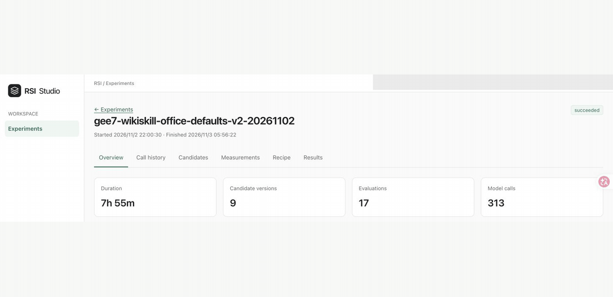

# 运行与检查实验

[English](running-experiments.md) | 简体中文 · [快速入门](../getting-started_zh.md)

本指南介绍如何校验、运行、检查、取消及重试实验，以及通过 CLI 与工作台排查问题。

从应当拥有实验 `.rsi/` 目录的工作区运行命令。Recipe 资源路径按声明文件解析，默认数据存储位置则取决于进程工作目录。分别启动的 CLI 和工作台从同一工作区运行时会读取同一存储。

## CLI 命令

使用 `arsi --help` 查看命令列表，使用 `arsi <command> --help` 查看某个命令的语法。在源码仓库中未全局安装时，可以使用 `pnpm arsi`。

| 命令                                   | 用途                                                                                          |
| -------------------------------------- | --------------------------------------------------------------------------------------------- |
| `arsi catalog`                         | 列出已注册插件和 Policy ID。                                                                  |
| `arsi list plugins`                    | 查看插件描述、契约、Schema 和兼容的 Policy 绑定。                                             |
| `arsi list policies`                   | 查看 Policy 描述、Schema、依赖和兼容插件。                                                    |
| `arsi doctor <recipe.yaml>`            | 检查生效配置、本地资源和运行前提，不运行实验。                                                |
| `arsi run <recipe.yaml>`               | 启动或续跑实验并保存记录。                                                                    |
| `arsi list`                            | 列出已保存的实验。                                                                            |
| `arsi show <experiment-id>`            | 输出已保存的实验状态、结果和错误信息。                                                        |
| `arsi cancel <experiment-id>`          | 向指定实验发送取消请求。                                                                      |
| `arsi cleanup [experiment-id]`         | [预览或清理实验资源](#清理实验资源)。                                                         |
| `arsi dashboard`                       | 在本机提供网页版的实验观察界面。                                                              |
| `arsi reflection list [experiment-id]` | 列出持久化版本，可按实验筛选。                                                                |
| `arsi reflection show <revisionID>`    | 检查版本内容与计划中的资源变更。                                                              |
| `arsi reflection apply <revisionID>`   | 将快照写到记录的用户资源路径；参见 [Reflection 规则](reflection_zh.md#将版本应用到后续实验)。 |
| `arsi help [command]`                  | 显示命令列表或指定命令的帮助。                                                                |

## CLI 参数

基本语法如下，命令所需的位置参数见上表：

```text
arsi [通用选项] <命令> [位置参数] [命令选项]
```

### 通用选项

以下选项适用于各个命令：

| 选项                       | 说明                                                                                                                                                                                      |
| -------------------------- | ----------------------------------------------------------------------------------------------------------------------------------------------------------------------------------------- |
| `-h, --help`               | 显示帮助并退出。`arsi --help` 显示命令列表，`arsi <command> --help` 显示该命令的参数。                                                                                                    |
| `--plugin-dir <directory>` | 从指定目录加载自定义插件和 Policy，可重复指定以加载多个扩展目录；详见[插件注册](writing-plugins_zh.md#第二步注册插件)和 [Policy 注册与 Recipe 配置](writing-policies_zh.md#注册-policy)。 |

### 命令专属选项

| 命令        | 选项                   | 说明                                                |
| ----------- | ---------------------- | --------------------------------------------------- |
| `run`       | `--id <experiment-id>` | 指定实验 ID；新实验省略时自动生成，续跑时必须提供。 |
| `run`       | `--resume`             | 用传入的 Recipe 继续已有实验，必须同时提供 `--id`。 |
| `dashboard` | `--port <port>`        | 指定监听端口，默认 `4317`，取值范围为 `1`–`65535`。 |

## 校验与启动

例如，可以通过下面的命令来校验 + 启动：

```sh
arsi doctor my-experiment/recipe.yaml
arsi run my-experiment/recipe.yaml --id terminal-skills-01
```

- `doctor` 检查 Recipe、插件配置、契约兼容性、Policy 编译和已声明的 Reflection 资源，再向注册了 `rsi/doctor` 的每个生效绑定派发事件。单份 JSON 报告包含 `recipeId`、`summary`、`checks` 和 `missingResources`。
  - 状态为 `passed`（通过）、`failed`（失败）或 `unchecked`（未检查）。
  - 检查流程、报告解读、内置检查和自定义组件接入方式，参见 [doctor 指南](doctor_zh.md)。

在同一工作区的另一终端中查看进度：

```sh
arsi list
arsi show terminal-skills-01
```

## 读取结果与证据

事实与痕迹位于 `.rsi/facts/`，不可变制品位于 `.rsi/artifacts/`，实验专属工作资源位于 `.rsi/experiments/<experiment-id>/`。

- 重试时需保留存储，并提供有效的 Recipe 及其引用的资源。

## 取消与恢复

```sh
arsi cancel terminal-skills-01
arsi show terminal-skills-01
```

取消只是请求，并不可以让所有工作立即停止。当发送请求时，Runtime 会传递取消信号并清理自身资源，需要检查最终状态和清理记录。

- 在运行 CLI 的终端按一次 Ctrl+C 会请求取消，并让 CLI 继续清理。如果 CLI 仍在运行，再按一次 Ctrl+C 可强制退出。

继续失败、取消或中断的实验时，沿用工作区、实验 ID 和所需扩展，并提供当前的 Recipe。

```sh
arsi run my-experiment/recipe.yaml --id terminal-skills-01 --resume
```

Runtime 恢复预算用量、兼容的生效版本、调用收据和检查点，校验传入的 Policy 形状后执行未完成的步骤。

旧版 Runtime 未保存控制流决策的实验需要用新实验 ID 重新启动。

- 续跑已成功的实验会再次调用清理处理器，并返回已保存的结果和原有用量。

- Policy 步骤的顺序、ID、类型、嵌套结构和所需的插件 contract ID 需要一致。新的调用按当前注册的输入和输出 schema 校验。
- Runtime 复用已完成的 Policy 步骤和已提交的结果，用传入的绑定、配置和代码执行未完成的步骤。对于已进入的条件分支、循环迭代和 foreach，会沿用之前选中的分支、迭代或条目。重试的插件调用使用新的尝试目录，并重新获取实例。
- 重试保留已记录的用量和原始开始时间。如果实验耗尽预算，可以修改 Recipe 中的预算。
- 上次执行释放实验锁，或进程崩溃后锁过期，即可重试未完成的调用，包括标记为 `unknown` 或停留在 `running` 的调用。Runtime 归档上次的调用收据和未确认的清理记录。外部操作的结果未知时，重试可能再次执行该操作。

## 清理实验资源

实验成功后，RSI 从当前和已归档的 Recipe 收集绑定，按 `(bindingId, pluginId)` 去重后逐个调用已注册的清理处理器。配置过但从未启动的插件也会收到通知。AgentBench 和 OperatorBench 会释放 SDK 确认可回收的资源。实验失败、取消或中断时，资源保留供重试或手动清理。

- `arsi cleanup` 或 `arsi cleanup --dry-run` 预览当前 `.rsi` 工作区可释放的资源。
- `arsi cleanup terminal-skills-01 --dry-run` 预览单个实验，执行 `arsi cleanup terminal-skills-01` 即可清理。
- `arsi cleanup --all` 批量清理当前工作区，跳过正在运行或恢复的实验。

自定义插件请传入运行实验时使用的 `--plugin-dir`。缺少插件时，该绑定会标为 `pending`，其他绑定仍会继续处理。

清理会保留检查点、结果、日志，以及其他实验仍在使用的资源。之后仍可用 `--resume` 续跑，所需镜像可能要重新拉取或构建。

## 工作台

```sh
arsi dashboard --port <端口号>
```

从已有 `.rsi/` 的实验工作区运行。工作台以web的形式展示实验、概览、候选、差异、测量、调用、Agent 轨迹、结果和图表，具体如下所示。

测量详情展示每个已记录条目的完整标识、对象类型、状态、覆盖范围和指标。失败、取消或状态未知的条目显示没有有效成绩，不展示数值结果；缺失条目证据会明确提示，成功评估的零分仍保留为零。
多个指标使用相同展示名称时，会补充原始指标名，便于区分各自的数值。

- 当前界面只读，启动、重试和取消通过 CLI 进行。
- Harness 结果增加 Delivered 列，链接到保存的选择结果所返回的测量，并显示对应阶段、状态与覆盖范围。交付均分仅使用已记录交付的可用分数，不以未选中的更高分替代；缺少选择记录时显示“Not recorded”。
- 默认将 `/api` 代理到 4317 端口。
- 没有专用报告的 Policy 在 Results 中也会展示最终输出产生前的已记录评估，并在完成后保留评估历史；最终候选仍只由保存的输出引用确定。评估列表同时显示状态与覆盖情况，失败或中断的测量不会提供最终分数。
- Results 同时展示实验记录中的执行错误。实验已经结束且没有最终输出时，页面明确显示未记录最终结果，并继续保留已有评估。



## 排障

| 现象                                   | 检查事项                                                                                                                     |
| -------------------------------------- | ---------------------------------------------------------------------------------------------------------------------------- |
| 未知插件、Policy 或未声明绑定          | 检查当前 catalog，在此进程加载扩展，并匹配 Policy 的 `require`。注意只有文件时并不构成注册。                                 |
| 预算耗尽或请求超时                     | 区分操作、评测、模型计数，墙钟时长，单请求时长，整个 Agent 时长，以及基准时长。参见 [限制](configuration_zh.md#限制与预算)。 |
| 工作台提示缺少 `.rsi` 或展示了其他实验 | 从原实验工作区启动，使用同一存储；                                                                                           |
| Memory 失败或 Reflection 被拒绝        | 检查保存的原因和后续流程。之前的经验或指导可能仍有效；失败与正常都不会影响整体实验流程。                                     |
