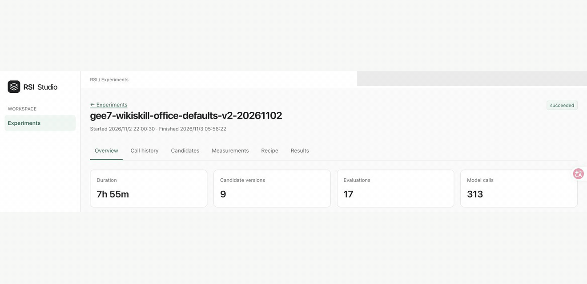

# 运行与检查实验

[English](running-experiments.md) | 简体中文 · [快速入门](../getting-started_zh.md)

本指南介绍如何校验、运行、检查、取消和恢复实验，以及通过 CLI 与工作台排查问题。

从应当拥有实验 `.rsi/` 目录的工作区运行命令。Recipe 资源路径按声明文件解析，默认数据存储位置则取决于进程工作目录。分别启动的 CLI 和工作台从同一工作区运行时会读取同一存储。

## CLI 命令

使用 `ember-rsi --help` 查看命令列表，使用 `ember-rsi <command> --help` 查看某个命令的语法。在源码仓库中未全局安装时，可以使用 `pnpm ember-rsi`。

| 命令                                        | 用途                                                                                          |
| ------------------------------------------- | --------------------------------------------------------------------------------------------- |
| `ember-rsi catalog`                         | 列出已注册插件和 Policy ID。                                                                  |
| `ember-rsi list plugins`                    | 查看插件描述、契约、Schema 和兼容的 Policy 绑定。                                             |
| `ember-rsi list policies`                   | 查看 Policy 描述、Schema、依赖和兼容插件。                                                    |
| `ember-rsi doctor <recipe.yaml>`            | 检查生效配置、本地资源和运行前提，不运行实验。                                                |
| `ember-rsi run <recipe.yaml>`               | 启动或续跑实验并保存记录。                                                                    |
| `ember-rsi list`                            | 列出已保存的实验。                                                                            |
| `ember-rsi show <experiment-id>`            | 输出已保存的实验状态、结果和错误信息。                                                        |
| `ember-rsi cancel <experiment-id>`          | 向指定实验发送取消请求。                                                                      |
| `ember-rsi dashboard`                       | 在本机提供网页版的实验观察界面。                                                              |
| `ember-rsi reflection list [experiment-id]` | 列出持久化版本，可按实验筛选。                                                                |
| `ember-rsi reflection show <revisionID>`    | 检查版本内容与计划中的资源变更。                                                              |
| `ember-rsi reflection apply <revisionID>`   | 将快照写到记录的用户资源路径；参见 [Reflection 规则](reflection_zh.md#将版本应用到后续实验)。 |
| `ember-rsi help [command]`                  | 显示命令列表或指定命令的帮助。                                                                |

## CLI 参数

基本语法如下，命令所需的位置参数见上表：

```text
ember-rsi [通用选项] <命令> [位置参数] [命令选项]
```

### 通用选项

以下选项适用于各个命令：

| 选项                       | 说明                                                                                                                                                                                      |
| -------------------------- | ----------------------------------------------------------------------------------------------------------------------------------------------------------------------------------------- |
| `-h, --help`               | 显示帮助并退出。`ember-rsi --help` 显示命令列表，`ember-rsi <command> --help` 显示该命令的参数。                                                                                          |
| `--plugin-dir <directory>` | 从指定目录加载自定义插件和 Policy，可重复指定以加载多个扩展目录；详见[插件注册](writing-plugins_zh.md#第二步注册插件)和 [Policy 注册与 Recipe 配置](writing-policies_zh.md#注册-policy)。 |

### 命令专属选项

| 命令        | 选项                   | 说明                                                      |
| ----------- | ---------------------- | --------------------------------------------------------- |
| `run`       | `--id <experiment-id>` | 指定实验 ID；新实验省略时自动生成，续跑时必须提供。       |
| `run`       | `--resume`             | 从保存的状态续跑，必须同时提供 `--id`；省略时启动新实验。 |
| `dashboard` | `--port <port>`        | 指定监听端口，默认 `4317`，取值范围为 `1`–`65535`。       |

## 校验与启动

例如，可以通过下面的命令来校验 + 启动：

```sh
ember-rsi doctor my-experiment/recipe.yaml
ember-rsi run my-experiment/recipe.yaml --id terminal-skills-01
```

- `doctor` 检查 Recipe、插件配置、契约兼容性、Policy 编译和已声明的 Reflection 资源，再调用每个生效组件定义上的可选 `doctor` 能力。单份 JSON 报告包含 `recipeId`、`summary`、`checks` 和 `missingResources`。
  - 状态为 `passed`（通过）、`failed`（失败）或 `unchecked`（未检查）。
  - 检查流程、报告解读、内置检查和自定义组件接入方式，参见 [doctor 指南](doctor_zh.md)。

在同一工作区的另一终端中查看进度：

```sh
ember-rsi list
ember-rsi show terminal-skills-01
```

## 读取结果与证据

事实与痕迹位于 `.rsi/facts/`，不可变制品位于 `.rsi/artifacts/`，实验专属工作资源位于 `.rsi/experiments/<experiment-id>/`。

- 恢复时需保留存储和原始资源文件。

## 取消与恢复

```sh
ember-rsi cancel terminal-skills-01
ember-rsi show terminal-skills-01
```

取消只是请求，并不可以让所有工作立即停止。当发送请求时，Runtime 会传递取消信号并清理自身资源，需要检查最终状态和清理记录。

- 在启动 CLI 的终端按 Ctrl+C 也会发送取消信号。

恢复时沿用工作区、原始 Recipe 路径、实验 ID 和所需扩展：

```sh
ember-rsi run my-experiment/recipe.yaml --id terminal-skills-01 --resume
```

Runtime 恢复锁定的定义、预算用量、生效版本、调用收据和检查点，并拒绝不兼容修改。

- 恢复不会重置计数或实验开始时间，已配置的墙钟预算包含中断期间。

## 工作台

```sh
ember-rsi dashboard --port <端口号>
```

从已有 `.rsi/` 的实验工作区运行。工作台以web的形式展示实验、概览、候选、差异、测量、调用、Agent 轨迹、结果和图表，具体如下所示。

- 当前界面只读，启动、恢复和取消通过 CLI 进行。
- 默认将 `/api` 代理到 4317 端口。



### 检查 Policy 结构

打开实验并选择 **Policy**，查看实验最初保存的 Policy 与 Recipe 定义。界面标明 Policy 和保存定义的摘要；修改本地源文件不会改变该快照。这是只读视图，不运行插件、不恢复资源，也不读取资源引用所指向的文件内容。

- 默认打开 **Flow**，从上到下展示顶层步骤。选择步骤可在详情面板查看声明与保存的配置。使用独立的展开按钮查看循环、集合体或分支；内层容器仍保持折叠，直到单独展开。
- **Data** 从左到右展示分组的数据源、步骤与输出，连线连接到字段或表达式位置。共享状态写入、输出映射和逐项绑定使用不同的关系标签。动态访问连接到静态可知的集合或对象边界，不标识运行时的具体元素。
- 选中步骤后切换视图，会定位到同一作用域中的步骤。Data 默认展示该步骤的直接关系；切换到 **Full graph** 可查看全部关系。未选择步骤时展示完整图。仅属于数据视图的数据源不对应流程步骤。
- 拖动可平移，使用缩放控件或 **Fit to view** 可调整图的可见范围。图获得焦点后，方向键用于平移，`+`/`-` 用于缩放，`Home` 用于适配完整图。在 Policy 页面保持挂载期间，各视图保留视口和展开状态。详情选择与容器展开使用独立、可通过键盘操作的控件。

分支和重复体展示声明中的可能路径，不展示执行状态、具体迭代，也不推断哪次写入提供了某个状态值。详情保留表达式原文，并区分保存的配置与运行时值。Reflection 详情仅描述初始配置；后续版本请查看 **Reflection & Memory**。

聚焦图和完整图都会持续显示分析不完整的提示。数据分析部分失败时，可靠的流程视图仍可使用。保存定义缺失、不受支持、无效或超出大小限制时会给出明确诊断；工作台不会改用当前源文件，也不会静默截断图。

首版最多接受 2,000 个步骤、合计 20,000 条关系与字段端口、64 层 JSON 声明嵌套，保存的输入和序列化后的结构响应分别不得超过 4 MiB。这些是拒绝阈值，不是分页范围。作为规模参考，使用确定性的保存绑定夹具投影当前 parameter-grid 和 Harness² 声明，分别得到 13 和 19 个步骤、49 和 84 条数据关系，以及约 94 和 164 KiB 的响应；这些测量没有执行插件。

## 排障

| 现象                                   | 检查事项                                                                                                                     |
| -------------------------------------- | ---------------------------------------------------------------------------------------------------------------------------- |
| 未知插件、Policy 或未声明绑定          | 检查当前 catalog，在此进程加载扩展，并匹配 Policy 的 `require`。注意只有文件时并不构成注册。                                 |
| 预算耗尽或请求超时                     | 区分操作、评测、模型计数，墙钟时长，单请求时长，整个 Agent 时长，以及基准时长。参见 [限制](configuration_zh.md#限制与预算)。 |
| 工作台提示缺少 `.rsi` 或展示了其他实验 | 从原实验工作区启动，使用同一存储；                                                                                           |
| Memory 失败或 Reflection 被拒绝        | 检查保存的原因和后续流程。之前的经验或指导可能仍有效；失败与正常都不会影响整体实验流程。                                     |
